<div align="center">

# Research Story Harness

### 从模糊研究意图，到有证据的故事，再到可编辑的科研表达

**Intent → Argument → Visual narrative → Figures · Manuscript · Slides**

12 个协作 skills · 可运行绘图后端 · 真实数据范例 · 可追溯来源 · 实际尺寸审阅

[](LICENSE)
[第三方代码与素材许可](THIRD_PARTY_NOTICES.md)

[**在线成品展厅**](https://research-story-harness-gallery.inwardchart4.chatgpt.site) · [看成图](#成图展厅) · [理解设计](#设计理念) · [开始使用](#开始使用) · [完整设计文档](design/HARNESS-DESIGN.md) · [Agent / Harness 方法论长文](design/AGENT-HARNESS-METHODOLOGY.zh-CN.md) · [许可与归属](THIRD_PARTY_NOTICES.md)

</div>

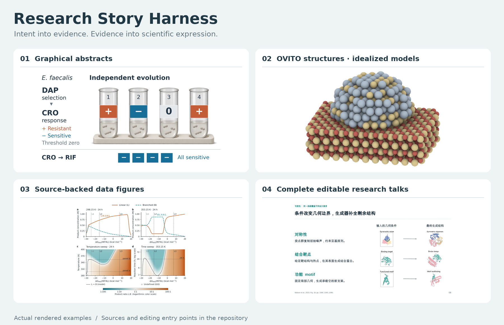

科研绘图的起点往往不是“画一张什么图”，而是一个尚未讲清的研究判断。这个项目把材料、作者意图、主张、证据和科学对象连接起来，再为 TOC、论文图、正文与汇报分别组织表达。你可以从一篇论文、一个数据集或一段零散想法开始，借助 agent 梳理论证，再用本地工具制作和修改成品。

**代码与文档采用 [Apache-2.0](LICENSE)。** 仓库包含 12 个 skills、绘图与汇报工具、模板和可运行示例。第三方代码、论文图像和数据按[各自许可](THIRD_PARTY_NOTICES.md)使用；其中反应能量示例的论文来源素材限非商业使用。

## 成图展厅

**[打开可直接分享的网站](https://research-story-harness-gallery.inwardchart4.chatgpt.site)**：TOC、Fig1、真实数据图的故事与历史前后对照，以及纳米颗粒、小分子封面和 RFdiffusion 汇报。支持桌面与手机；[网页源码与重建方法](docs/SHOWCASE.md)。

下面的示例提供成图、来源、可编辑文件和重建入口。网页预览随屏幕缩放；按刊载尺寸查看请打开对应 PDF。

### 01 · TOC：一个选择条件，四个独立结果

<p align="center">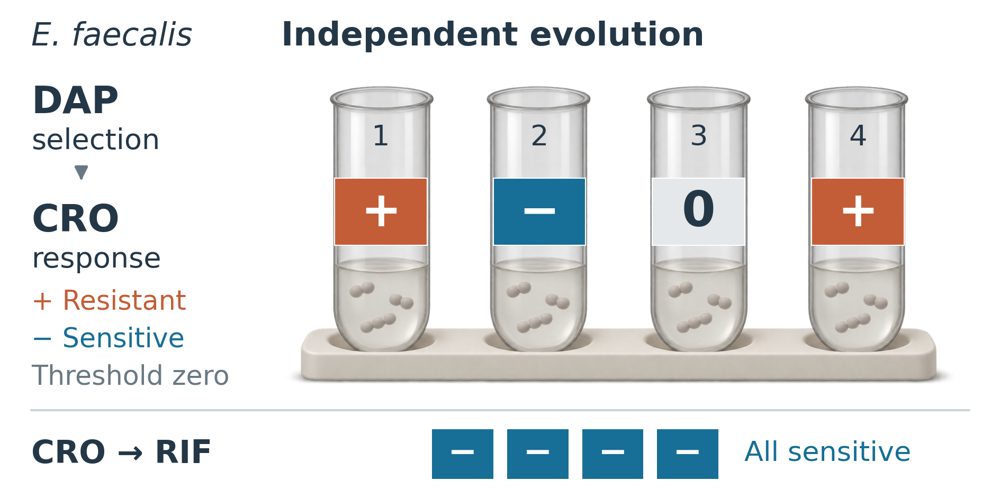</p>

**核心故事：同一选择压力不保证相同的旁系响应。** 四个分开的实验对象与四个结果一一对应，下方一致响应作为对照。这里的主体是实验单位和差异，而非一排装饰性分子或研究步骤。

- **目标：80 × 40 mm。** [PDF](examples/collateral-response/figures/TOC.pdf) · [SVG](examples/collateral-response/figures/TOC.svg) · [源码与数据](examples/collateral-response/)
- 培养容器、细胞与支架是中性的生成式概念插画；身份、符号和结果是单独的矢量层。插画不是实验照片，也不编码死亡或增殖。
- 真实结果来自 Maltas & Wood, *PLOS Biology* (2019), [10.1371/journal.pbio.3000515](https://doi.org/10.1371/journal.pbio.3000515)，归属与数据范围见[示例说明](examples/collateral-response/README.md)。

### 02 · Fig1：让实验单位一路进入证据

<p align="center">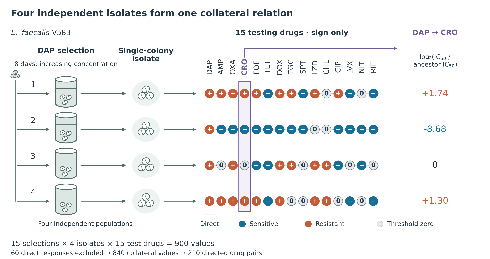</p>

四条连续的样本行串起**独立群体 → 单菌落分离株 → 响应方向 → 局部数值**。完整矩阵保留身份，局部强调读取原位 CRO 列；颜色与等大标记只编码方向，右端数值才表达幅度。

**目标：178 × 94 mm。** [PDF](examples/collateral-response/figures/Fig1.pdf) · [SVG](examples/collateral-response/figures/Fig1.svg) · [编辑入口](examples/collateral-response/README.md)

### 03 · 数据图：从全局模式走向可核查的例子

<p align="center">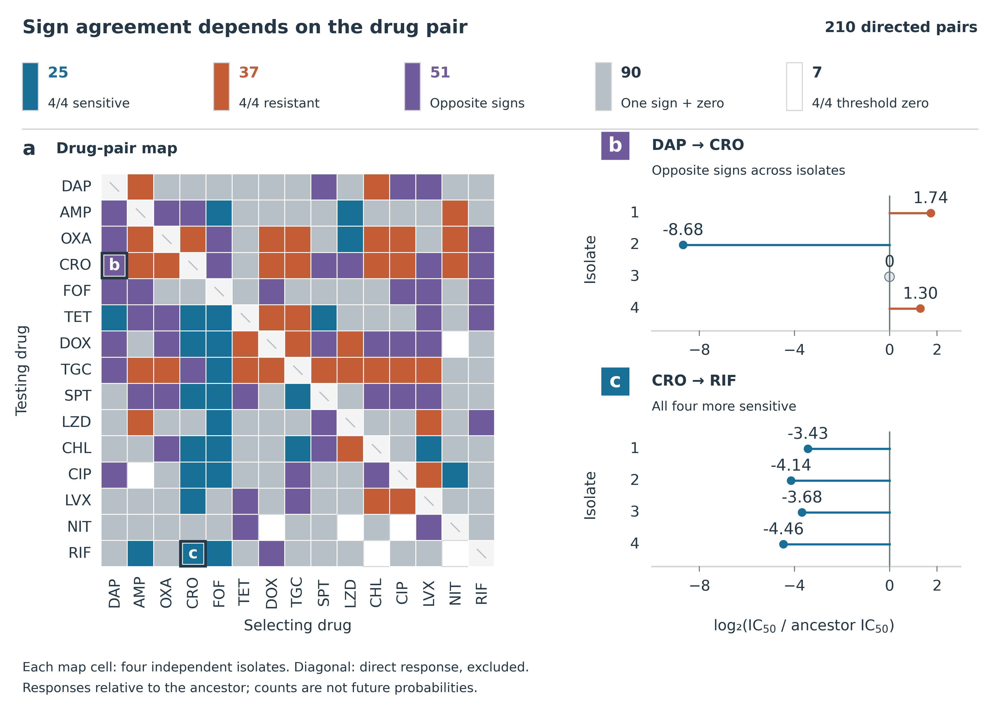</p>

左侧是药物对的类别地图，右侧两组例子解释类别的含义；一致的横轴便于比较响应幅度。顶部计数回答“这些关系有多少”，没有把样本内计数解释成未来成功概率。

**目标：178 × 126 mm。** [PDF](examples/collateral-response/figures/Evidence.pdf) · [SVG](examples/collateral-response/figures/Evidence.svg) · [数据与重建](examples/collateral-response/)

**这组三图的验证边界：** 900 个源矩阵值对应 60 个分离株 × 15 个测试药；排除直接选择响应后为 840 个旁系值、210 个有方向药物对。源阈值零不等于“完全没有生物效应”。完整阈值定义、数据映射和推断范围见[图注](examples/collateral-response/captions.md)。

### 04 · 条件地图：活性和选择性依赖条件

<p align="center">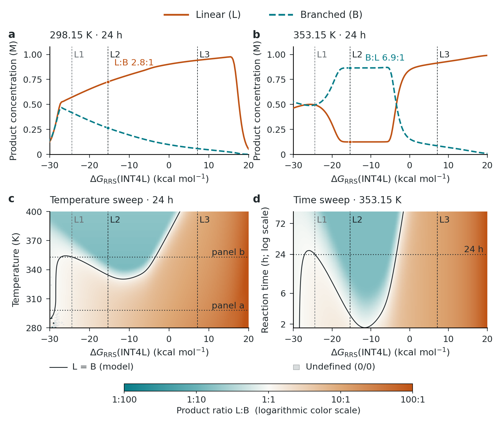</p>

以曲线建立量的意义，再用温度和时间地图展示条件依赖。真实数组来自 Worakul et al., *ACS Catalysis* (2024), [10.1021/acscatal.4c01175](https://doi.org/10.1021/acscatal.4c01175) 的作者存档；数据采用 **CC BY 4.0**。

[数据、H5 原始数组、运行代码与配置](skills/research-harness/assets/real-data-examples/condition-map/) · [来源与处理](skills/research-harness/assets/real-data-examples/condition-map/SOURCES.md)

**目标：148.16 × 126 mm。** 这是 Fig.4 d–g 的重新组织，未包含原化学机理面板。色标是 log₁₀(L/B)，不是置信度；本示例不重新求解微观动力学。

### 05 · 能量与真实结构：把几何锚定到路径

<p align="center">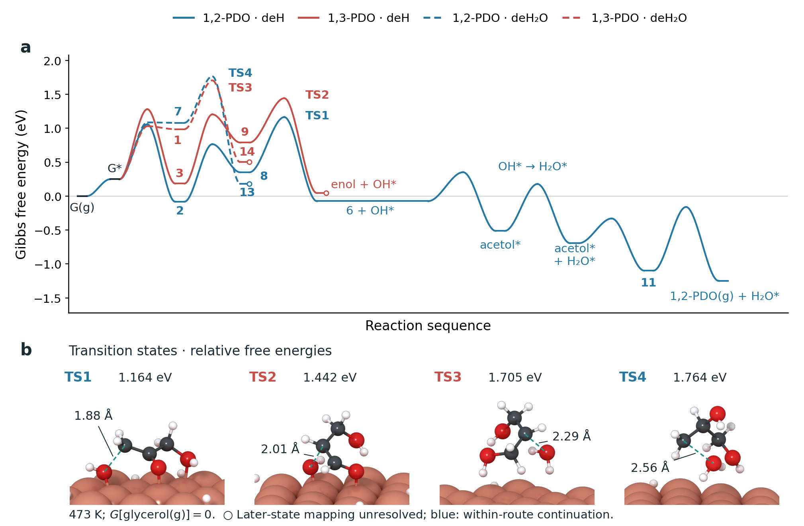</p>

能量路径与四个真实坐标 TS 同时呈现，各自承担不同证据角色。后期映射未解决的路径保留空心终点；导引线不能冒充连续 PES 计算，原子距离也不单独证明机理。

[能量 CSV、坐标、图形资产与代码](skills/research-harness/assets/real-data-examples/reaction-energy/) · [来源与限制](skills/research-harness/assets/real-data-examples/reaction-energy/SOURCES.md)

**目标：171 × 112 mm。** 来源 Kang et al., *Chemical Science* (2022), [10.1039/D2SC02107B](https://doi.org/10.1039/D2SC02107B)，该例的论文来源材料保留 **CC BY-NC 3.0** 非商业限制。结构是位图渲染，曲线、文字和距离标注可编辑。示例展示局部能量与结构，不宣称完整复现原反应网络。

### 06 · OVITO：纳米颗粒与载体，有材质也有来源边界

<p align="center">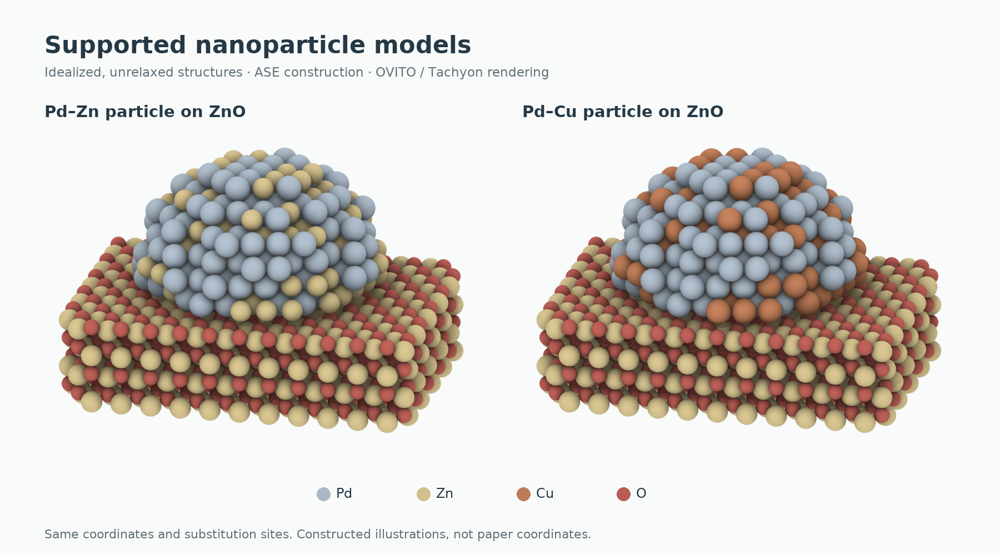</p>

密排球径、柔和环境遮蔽、低高光材质和统一正交相机，让颗粒轮廓与接触界面同时可辨。两个模型共用坐标和替换位点，仅改变指定位置的元素，避免把视角或粒形差异混入对照。

**这是 ASE 构造的未弛豫理想示意模型，不是论文坐标或实测结构。** 每个模型含 1,413 个原子；构造参数和界面间距是本例示意选择。透明成图为 2000 × 1375，采用 OVITO 3.16.0 / Tachyon 渲染。你可以修改坐标、相机和显示配置后重新渲染。

[透明原图、坐标、构造源码、相机和光照配置](examples/supported-nanoparticles/) · [独立 OVITO skill](skills/ovito-structure/SKILL.md)

### 独立结构封面：实际 Blender 材质与构图迭代

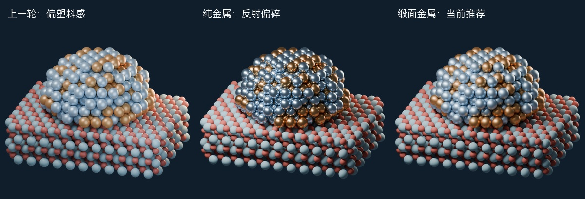

**同一结构，三种实际渲染。** 左侧是偏塑料感的旧版，中间强化金属反射但高光偏碎，右侧提高粗糙度并调整矩形灯光，平衡金属感与小图清晰度。1413个原子的坐标、显示半径和相机均保持不变；这些是显示材质，不是材料光学参数或显微照片。

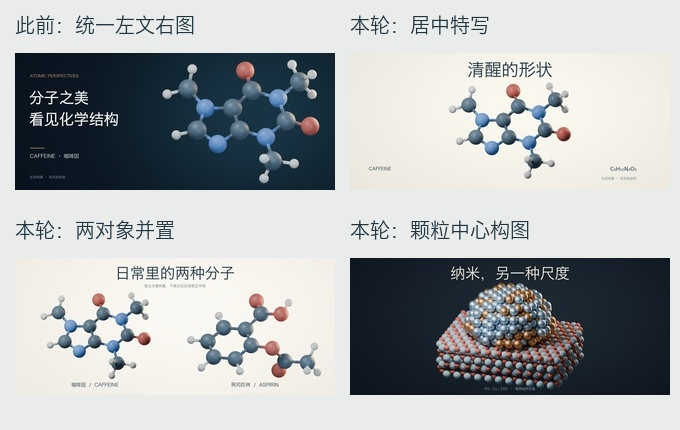

小分子不再统一采用左文右图：居中特写突出单对象，并置适合比较两个独立对象，方形封面单独重排。它们服务不同的文章任务，不宣称某种布局总是更好或已提升点击率。

<p align="center">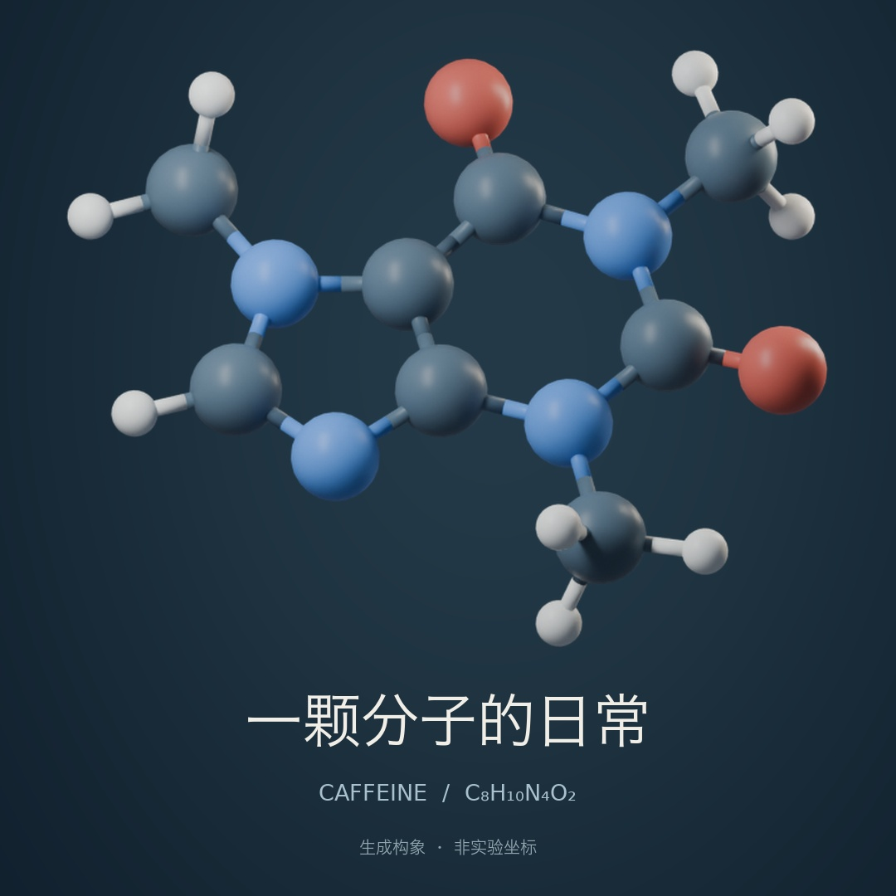</p>

**[在线展厅与大图](https://research-story-harness-gallery.inwardchart4.chatgpt.site#material)** · [GitHub 图文版](docs/structure-covers.md) · [下载、来源与可运行代码](examples/structure-covers/) · [轻量 skill](skills/structure-cover/SKILL.md)

```bash
# 快速重排：使用随包无损结构渲染，输出JPEG/PNG、可编辑文字SVG和缩略图
python -m pip install -r examples/structure-covers/requirements.txt
python examples/structure-covers/run.py --out build/covers
# 从结构重新渲染，同时生成可编辑 .blend
python examples/structure-covers/run.py --out build/covers-full --blender /path/to/blender
```

纳米颗粒是已公开的 ASE 理想未弛豫模型；咖啡因和阿司匹林是有明确拓扑的生成构象，均非实验坐标。原始来源、完整坐标、材质与灯光配方、不同布局及字体配置均有[编辑入口](examples/structure-covers/README.md)。未包含内部论文材料。

### 07 · 完整汇报：从复杂论文到听众能跟随的讲述

**RFdiffusion · 20 页中文汇报 · 18 页主讲 + 2 页备份**

<p align="center">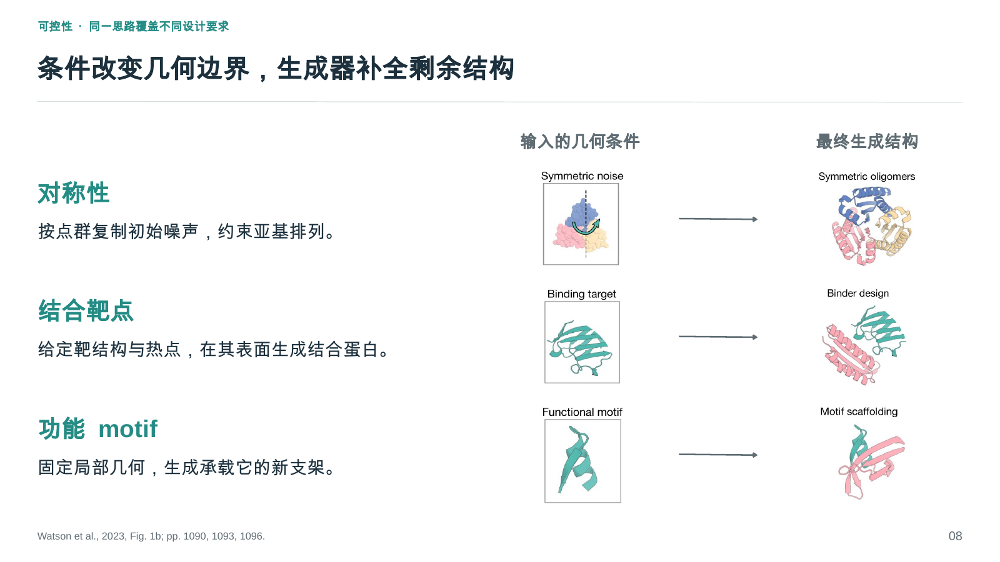</p>

<p align="center">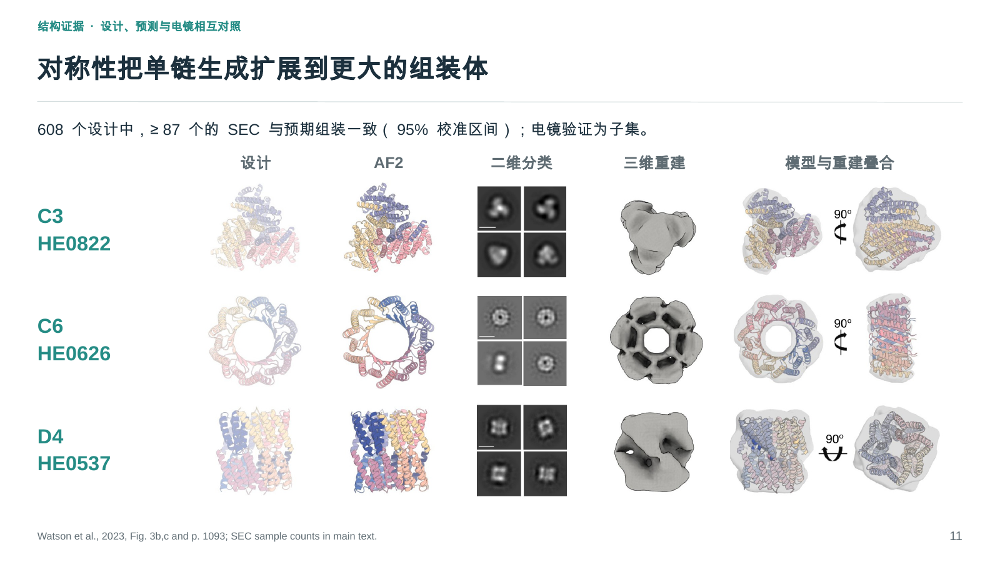</p>

方法页先建立“输入约束如何作用于生成”的理解，证据页再用相同对象逐列对照设计、预测与实验。页面承担不同的讲述任务；完整讲稿保留实验口径、分母和结论限定。

[**下载可编辑 PPTX**](examples/rfdiffusion/RFdiffusion.pptx) · [完整 PDF](examples/rfdiffusion/RFdiffusion.pdf) · [20 页预览](examples/rfdiffusion/slides/) · [页面源与素材](examples/rfdiffusion/) · [逐页讲稿](examples/rfdiffusion/speaker-notes.md)

<details>
<summary>展开整套汇报概览</summary>

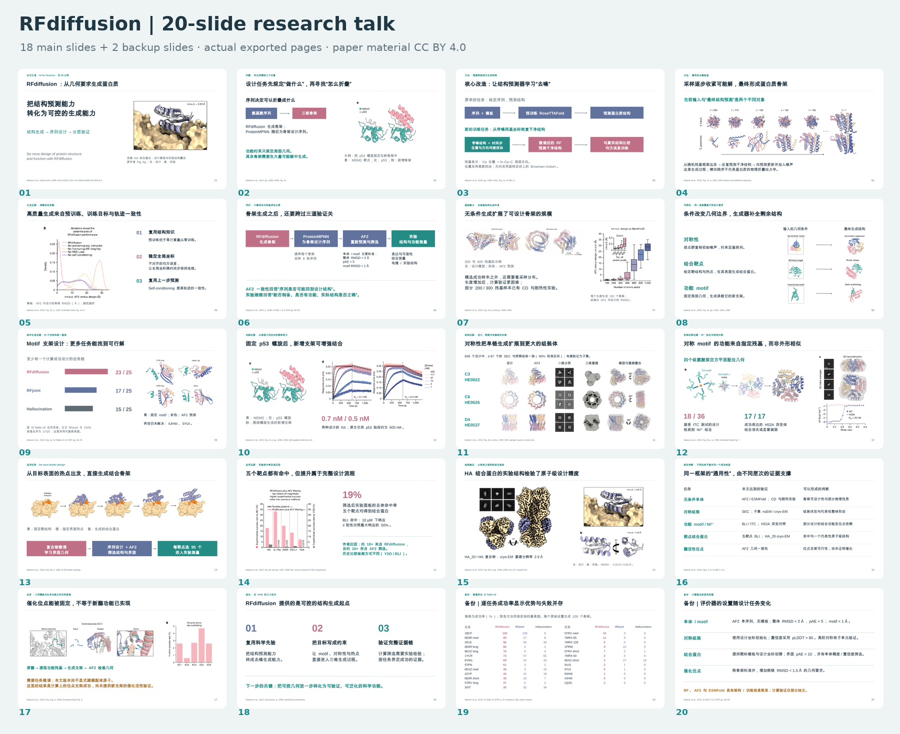

</details>

来源 Watson et al., *Nature* (2023), [10.1038/s41586-023-06415-8](https://doi.org/10.1038/s41586-023-06415-8)，论文图像与数据保留 **CC BY 4.0** 归属。标题、说明、节点与新增数据图表为 PPT 原生对象；蛋白结构和原文图像仍为位图。示例同时提供讲稿、来源定位和重建命令，便于调整受众、讲述顺序与版式。

## 设计迭代：让对象承担叙事

<p align="center">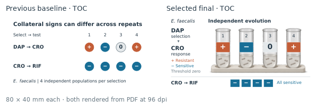</p>

两版使用相同数据。前一版突出符号关系，后一版用四个独立实验对象承载身份与结果，使读者更容易理解比较单位。写实插画只是这项任务的一种选择；其他任务可使用结构、路径或定量编码。

[三图源文件与原生尺寸检查](examples/collateral-response/) 保留可编辑入口。请在目标尺寸的 PDF 中检查文字与局部细节。

## 设计理念

### 意图先行，但不把作者的愿望当成证据

材料先进入可追溯的来源和主张记录。代理提出叙事候选、指出缺少的一跳、区分观察与解释，和作者逐步把模糊想法变成可讨论的研究逻辑。关键未知才需要人类判断；不要求作者一开始就知道画什么图。

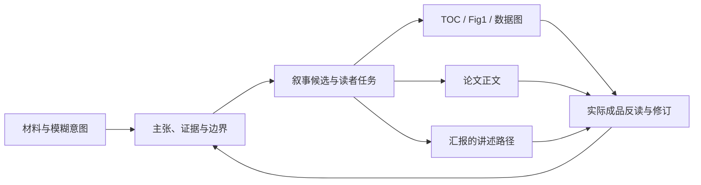

### 同一故事，分别设计表达方式

| 表达 | 读者需要完成的任务 | 设计重点 |
|---|---|---|
| TOC | 快速认识研究对象、核心作用与结果关系 | 在目标小画幅中选择一个主要事件 |
| Fig1 / 概览 | 理解研究如何成立、对象如何进入证据 | 维持身份、尺度与关键关系 |
| 数据图表 | 比较量、趋势、条件和不确定性 | 数值来源、编码、参照与误差定义 |
| 机制 / 结构图 | 理解状态变化、竞争路径或空间作用 | 科学对象、局部几何和有意义的连接 |
| 正文 | 建立可支持的论证 | 主张与证据的覆盖、限定及衔接 |
| 完整汇报 | 按听众理解顺序逐步建立判断 | 前提、方法必要性、关键证据与后段收束 |

图与 slide 共用主张和来源，**不强制共用叙述顺序或版式**。给一篇论文即可启动汇报制作，不需要先写逐页提纲；编辑性按最终载体说明，图片、SVG 源文件和 PPT 内原生对象不混为一谈。

### 这套 harness 着重解决什么

| 设计取舍 | 可检查的实现 |
|---|---|
| 从不知道画什么开始 | [故事共构](skills/research-harness/references/story-discovery.md)，来源、候选、主张及未决选择 |
| 科学对象和论证先于模板 | [科学绘图 skill](skills/scientific-figure/SKILL.md)，任务、关系与图件职责拆解 |
| 同一事实体系，多种媒介 | [跨表示关联](skills/research-harness/references/cross-representation.md)，共享 ID 与变化后复核 |
| 持续修改有明确入口 | 数据、图形语义、样式与资产分别维护；定向修改和关联检查 |
| 字体统一仍允许层次 | 字体角色、单位和化学正体、变量斜体、物理尺寸分面，而非全局一键缩放 |
| 结构不能凭图猜造 | [OVITO skill](skills/ovito-structure/SKILL.md)，真实坐标与明确授权理想模型分开 |
| 视觉质量有独立反馈 | [首稿与盲评](skills/research-harness/references/first-draft-and-blind-review.md)，保留失败稿与实质返工 |

这些组件可以分别使用，也可以围绕同一份研究材料组成连续工作流。

## 能力与边界

支持的后端包括 paired、table、energy、energy_network、methods、series、structure3d、catalyst_surface、toc、schematic、summary 和 recipe。复杂图可用项目自己的可审阅绘图代码；共享约束连接来源和编辑入口，而不要求所有学科套同一布局。

适合需要保留数据来源、编辑结构与持续修订的科研表达任务。复杂材料通常需要多轮修改：研究者负责确认主张和证据边界，成品应在实际使用尺寸下审阅。示例展示经过修订的结果，不代表任意输入都能一次达到相同质量。

程序检查关注字段、引用、数值绑定、导出与有限几何；科学判断检查主张是否得到支持；视觉审阅看故事、主次、密度、字体、材质与阅读路径。三者分别记录。

## 开始使用

### 1. 获取并准备环境

```bash
git clone https://github.com/Phorbol/research-story-harness.git
cd research-story-harness
python3 -m venv .venv
source .venv/bin/activate
python -m pip install -r requirements.txt
```

建议 Python 3.12。三维结构、参考 PDF、源 H5 提取和幻灯片的额外依赖见 [DEPENDENCIES.md](DEPENDENCIES.md)。核心工具不需要预先下载论文或模型权重；agent 宿主、模型和联网检索由使用环境提供。

### 2. 安装或直接使用 skills

```bash
# 复制到当前 Codex 用户的 skills 目录；已有同名技能会拒绝覆盖
python install_skills.py

# 或安装到自选目录；不会自动安装 Python 依赖
python install_skills.py --dest ./installed-skills
```

也可以不安装，直接让支持读取本地指引的 agent 访问 `skills/<name>/SKILL.md`。本仓库不是后台自动运行服务。

### 3. 给论文或数据，选择一个起点

将下面一段交给能读取本仓库的 agent，并替换方括号中的内容。无需先写完整图纲；不知道主线时也可以直接说“还不确定想表达什么”。**这些是交给 agent 的任务提示，不是终端命令。** 本仓库提供方法、状态与渲染工具，不包含自动理解任意 PDF 的一键服务。

**我有一篇论文：** 提供可访问的全文 PDF 或公开链接；若希望重绘定量图，同时提供或允许检索补充材料、Source Data。只有论文图片时，不能默认拥有原始数值。

```text
请从本仓库读取 skills/research-harness/SKILL.md 和
skills/scientific-figure/SKILL.md，按需读取它们链接的说明。
论文：[PDF 路径或公开链接]；补充数据：[路径/链接，或请检索]。
我的模糊想法：[一句判断；也可以写“请帮我找主线”]。
读者：[学科背景]；用途：[论文/文献解读/投稿草稿]。
先区分论文事实、我的推测和材料缺口，提出两种叙事，
再选择有证据支持的一种；关键歧义再问我。
制作 TOC、Fig1 概览和一张真实数据图，分别明确读者任务。
目标尺寸：TOC 80×40 mm；Fig1 178×100 mm；数据图178×120 mm。
这些是本次工作尺寸，不是期刊官方要求；不得扩大后缩小交差。
保持科学对象、条件和对照，不把全部内容变成普通流程框。
保留第一份完整成图及之后的每轮实质修改，按实际尺寸看图。
交付 PDF、SVG/可编辑源、PNG、正常图注、来源映射和重建命令。
缺失原始数据时先报告缺口；不得用合成数值冒充论文结果。
```

**我有一组数据：** 提供 CSV/XLSX/H5 等文件，尽量说明列名、单位、样本/重复、分组、对照与缺失值。并非每份数据都适合强行做 TOC 和方法图；没有方法信息时应先补充，而非编造研究过程。

```text
请从本仓库读取 research-harness 与 scientific-figure 的 SKILL.md。
数据：[路径]；每行代表：[样本/时间点/计算状态等]。
单位、重复、对照和缺失值定义：[已知信息，未知请标明]。
我想弄清：[问题或模糊观察]；目标读者：[背景]。
先检查数据结构与证据范围，提出能支持判断的图件方案。
不要预设图型；区分连续数值热图、类别矩阵和普通表格。
在确定的目标尺寸内制作真实数据图，给出可追溯的数据处理。
若方法材料足够，再设计 Fig1 与 TOC，并分别验收。
保留首稿、修改原因和可编辑源；不把相关性画成因果。
```

默认先做可修订图稿；期刊规范、投稿用途或尺寸有明确要求时，以用户提供并核实的要求替换示例值。科学主张、视觉完成度和程序检查分别评估。提示词本身不保证任意模型一次达到展厅的效果。

**我需要完整汇报或结构封面：**

- 汇报：读取 `skills/ansatz-slide/SKILL.md`，提供论文、听众背景、汇报时长与希望听众记住的判断；要求完整 PPTX、讲稿、可编辑源与逐页实际渲染审阅。不要直接照搬论文章节顺序。
- 结构封面：读取 `skills/structure-cover/SKILL.md`，提供真实坐标、封面尺寸和用途；无坐标时先说明缺口，构造理想模型须明确授权并标注。Blender/OVITO 的材质、灯光和相机效果主要由配方参数决定，不靠一句外观提示稳定复现。

### 4. 先重建一套公开成品，确认环境与编辑入口

以下都是**终端命令**，在仓库根目录、上述虚拟环境中运行。它们重建已定义的案例，不会自动把你的新数据套入这些论文的结论。

```bash
# 同一故事的 TOC、Fig1 与数据图；输出 PDF / SVG / PNG
python examples/collateral-response/scripts/rebuild.py TOC --out "$PWD/build/collateral"
python examples/collateral-response/scripts/rebuild.py Fig1 --out "$PWD/build/collateral"
python examples/collateral-response/scripts/rebuild.py Evidence --out "$PWD/build/collateral"

# 从作者公开数据重建计算催化条件地图
python skills/research-harness/assets/real-data-examples/condition-map/run.py --out build/condition-map

# 快速重排结构封面；完整重新渲染另加 --blender /path/to/blender
python examples/structure-covers/run.py --out build/covers
```

| 想改什么 | 编辑入口 |
|---|---|
| 三图的数据、对象、布局和字体 | [示例说明](examples/collateral-response/README.md)、[样式配置](examples/collateral-response/style-profile.json)、[真实数据](examples/collateral-response/data/) |
| 条件地图的刻度、图例、条件和源数组 | [运行与数据定义](skills/research-harness/assets/real-data-examples/condition-map/README.md)、[config.json](skills/research-harness/assets/real-data-examples/condition-map/config.json) |
| 纳米颗粒/小分子的材质、灯光与封面布局 | [结构与配方](examples/structure-covers/README.md) |
| 完整科研汇报 | [RFdiffusion 的 PPTX、讲稿、页面源与重建命令](examples/rfdiffusion/README.md) |

[在线展厅](https://research-story-harness-gallery.inwardchart4.chatgpt.site/#science)展示实际成品和真实修改前后；[提示示例](https://research-story-harness-gallery.inwardchart4.chatgpt.site/#prompts)可直接复制。重建成功只确认运行链路，不等于新论文设计已达标。

### 5. 新材料的项目与交付

让 agent 根据材料组织项目；需要本仓库的状态和渲染接口时，可先初始化空项目：

```bash
python skills/research-harness/scripts/research.py init ./my-study
cd my-study
# agent 登记来源、主张、数据、对象与图件规格后，再执行：
python scripts/research.py check research.json
python scripts/research.py render research.json --out build
```

`init` 不是“论文转图片”命令；刚初始化的项目没有你的科学内容。复杂图允许在案例内编写可审阅的绘图代码，不要求全部套内置模板。只想了解接口时可在另一空目录使用 `init --demo`，其合成数据不得用于真实结果。

完成时至少应拿到：**实际尺寸成图、可编辑源和重建命令、源数据与图注、首稿及返工记录、明确的剩余问题**。SVG 里嵌入的位图不等于逐对象可编辑；图看得懂、没有碰撞或检查通过，也不自动等于发表级质量。

## 12 个协作 skills

| Skill | 职责 |
|---|---|
| [source-harvester](skills/source-harvester/SKILL.md) | 收集来源、范例与适用边界 |
| [paper-dissector](skills/paper-dissector/SKILL.md) | 拆解论文的论证和图表任务 |
| [argument-architect](skills/argument-architect/SKILL.md) | 建立可追溯主张、贡献与故事候选 |
| [context-pack-builder](skills/context-pack-builder/SKILL.md) | 组织期刊、领域和研究设计上下文 |
| [academic-writing](skills/academic-writing/SKILL.md) | 科研写作入口与协作 |
| [manuscript-editor](skills/manuscript-editor/SKILL.md) | 起草、重构与候选修订 |
| [manuscript-auditor](skills/manuscript-auditor/SKILL.md) | 核对支持关系与修订引入的问题 |
| [scientific-figure](skills/scientific-figure/SKILL.md) | 从科学任务设计图形语言 |
| [research-harness](skills/research-harness/SKILL.md) | 项目状态、渲染、定向修改与检查 |
| [ovito-structure](skills/ovito-structure/SKILL.md) | 原子、晶体、表面与颗粒渲染 |
| [ansatz-slide](skills/ansatz-slide/SKILL.md) | 从论文到完整可编辑学术汇报 |
| [structure-cover](skills/structure-cover/SKILL.md) | 保留分子/材料结构，制作 OVITO／Blender 封面与缩略图 |

按任务使用相应入口，不要求每次全套执行。Slide 实现基于 [ansatzX/ansatz-slides](https://github.com/ansatzX/ansatz-slides) 的固定 MIT 版本；本项目增加共享科研故事与汇报组织方法，保留上游归属和修改记录。

## 运行验证、许可与贡献

- [验证记录](VERIFICATION.md)：在独立公开目录实际运行的检查、环境与未覆盖项。测试通过不代表图形已达到发表级。
- [完整设计文档](design/HARNESS-DESIGN.md)：状态、角色、数据契约、反馈路径和边界。
- [依赖](DEPENDENCIES.md)：按所需后端安装，避免把本机环境当成可移植保证。
- [第三方归属](THIRD_PARTY_NOTICES.md)：MIT 上游、CC BY 与 CC BY-NC 数据的不同适用范围。

欢迎通过 [Issues](https://github.com/Phorbol/research-story-harness/issues) 提交问题与示例。请附可公开分享的最小材料、表达目标、目标尺寸和复现步骤；涉及图件时，附上当前导出与希望改进的位置。

## 许可证

本项目原创代码、skills、模板和文档采用 [Apache License 2.0](LICENSE)。随附的第三方软件及论文来源素材保留原许可，具体路径与再利用条件见 [THIRD_PARTY_NOTICES.md](THIRD_PARTY_NOTICES.md)。该授权不覆盖第三方商标或替代科学内容审核。

---

**English summary.** Research Story Harness connects research intent, evidence, argument and scientific objects to editable figures, manuscripts and presentations. It packages twelve cooperating skills, executable rendering tools, reusable components and source-backed examples. Figure design starts from the reader's task; a talk reorganizes the same evidence for an audience rather than copying paper order. Use the examples to inspect the output, run the code, and adapt the editable sources to your own materials. Original code and documentation are licensed under Apache-2.0. Third-party code, paper figures and data retain their own licenses; the optional reaction-energy paper assets are CC BY-NC 3.0.
