<div align="center">

# Research Story Harness

### 从模糊研究意图，到有证据的故事，再到可编辑的科研表达

**Intent → Argument → Visual narrative → Figures · Manuscript · Slides**

11 个协作 skills · 可运行绘图后端 · 真实数据范例 · 可追溯来源 · 实际尺寸审阅

[看成图](#成图展厅) · [理解设计](#设计理念) · [开始使用](#开始使用) · [完整设计文档](design/HARNESS-DESIGN.md) · [许可与归属](THIRD_PARTY_NOTICES.md)

</div>

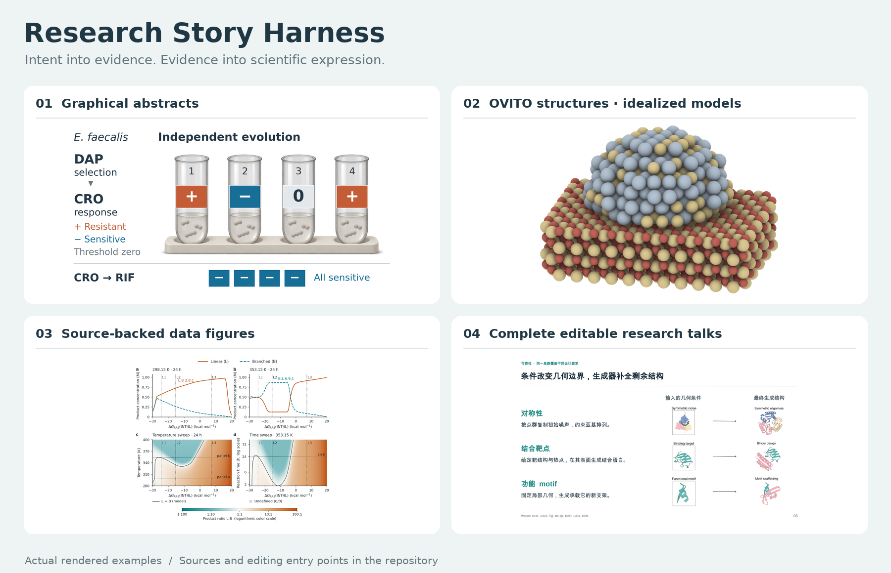

科研绘图的起点往往不是“画一张什么图”，而是一个尚未讲清的研究判断。这个项目把材料、作者意图、主张、证据和科学对象连接起来，再为 TOC、论文图、正文与汇报分别组织表达。它同时提供 agent 的工作方法与本地执行工具，不能脱离理解材料和实际看图，自动认证科学正确性或发表质量。

**当前公开的是完整的通用工具链。** 包括 11 个 skills、源码、模板、安装器、设计文档和可再分发实例；个人文稿、聊天记录、未获再分发许可的输入及本机环境不在仓库中。公开可见不等于所有文件统一采用 MIT；第三方资产保留各自许可，首方代码尚未指定开放源码许可证。

## 成图展厅

以下是实际导出，不是设计效果图。页面上的图片会随屏幕缩放；毫米尺寸以链接中的 PDF 为准。示意图与数据图分别说明它们承担的任务，精修后的成品不冒充零反馈首稿。

### 01 · TOC：一个选择条件，四个独立结果

<p align="center">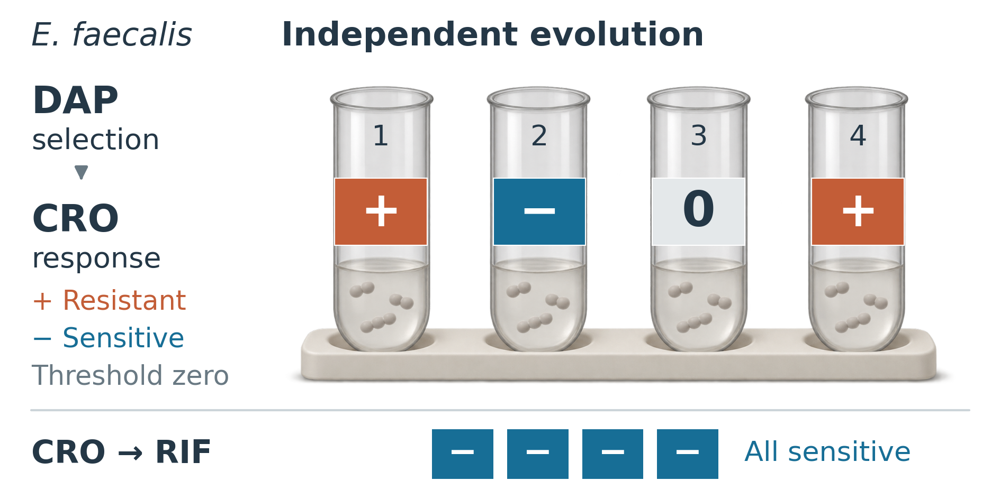</p>

**核心故事：同一选择压力不保证相同的旁系响应。** 四个分开的实验对象与四个结果一一对应，下方一致响应作为对照。这里的主体是实验单位和差异，而非一排装饰性分子或研究步骤。

- **目标：80 × 40 mm。** [PDF](examples/collateral-response/figures/TOC.pdf) · [SVG](examples/collateral-response/figures/TOC.svg) · [源码与数据](examples/collateral-response/)
- 培养容器、细胞与支架是中性的生成式概念插画；身份、符号和结果是单独的矢量层。插画不是实验照片，也不编码死亡或增殖。
- 真实结果来自 Maltas & Wood, *PLOS Biology* (2019), [10.1371/journal.pbio.3000515](https://doi.org/10.1371/journal.pbio.3000515)，归属与数据范围见[示例说明](examples/collateral-response/README.md)。

### 02 · Fig1：让实验单位一路进入证据

<p align="center">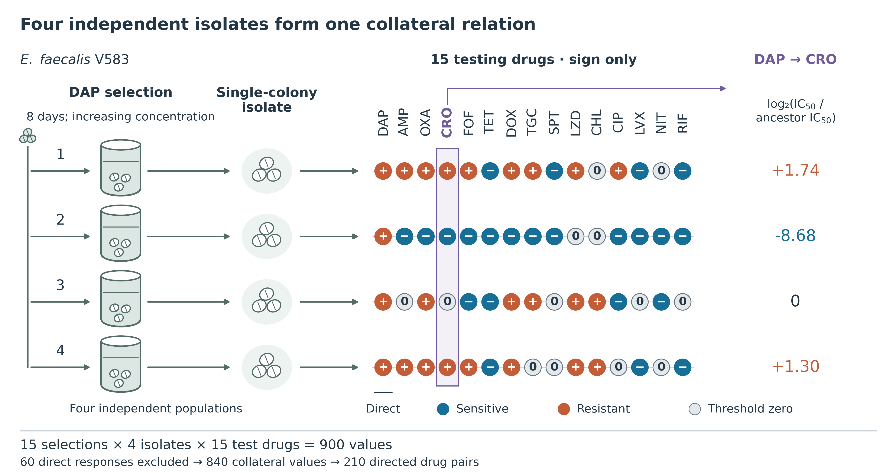</p>

四条连续的样本行串起**独立群体 → 单菌落分离株 → 响应方向 → 局部数值**。完整矩阵保留身份，局部强调读取原位 CRO 列；颜色与等大标记只编码方向，右端数值才表达幅度。

**目标：178 × 94 mm。** [PDF](examples/collateral-response/figures/Fig1.pdf) · [SVG](examples/collateral-response/figures/Fig1.svg) · [编辑入口](examples/collateral-response/README.md)

### 03 · 数据图：从全局模式走向可核查的例子

<p align="center">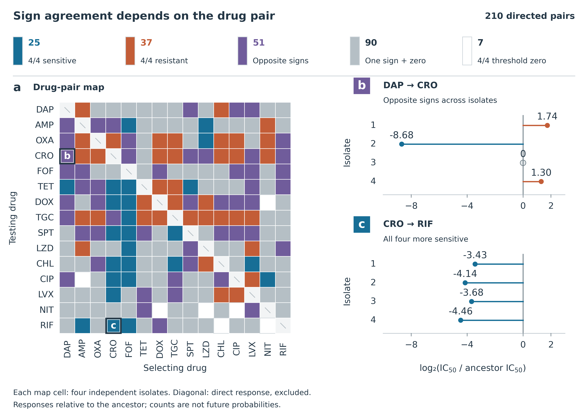</p>

左侧是药物对的类别地图，右侧两组例子解释类别的含义；一致的横轴便于比较响应幅度。顶部计数回答“这些关系有多少”，没有把样本内计数解释成未来成功概率。

**目标：178 × 126 mm。** [PDF](examples/collateral-response/figures/Evidence.pdf) · [SVG](examples/collateral-response/figures/Evidence.svg) · [数据与重建](examples/collateral-response/)

**这组三图的验证边界：** 900 个源矩阵值对应 60 个分离株 × 15 个测试药；排除直接选择响应后为 840 个旁系值、210 个有方向药物对。源阈值零不等于“完全没有生物效应”。本轮经过独立制作与多轮评审辅助精修；独立上下文的模型审阅不等于人类领域专家或期刊认可。

### 04 · 条件地图：活性和选择性依赖条件

<p align="center">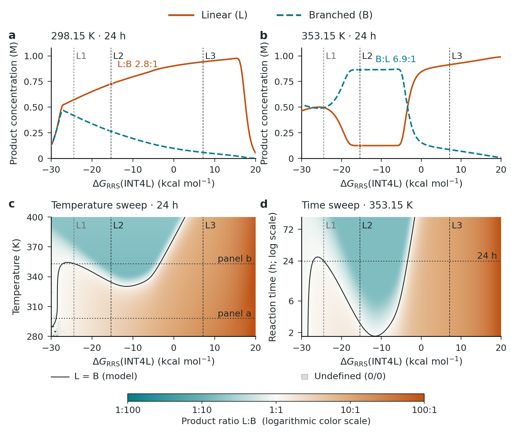</p>

以曲线建立量的意义，再用温度和时间地图展示条件依赖。真实数组来自 Worakul et al., *ACS Catalysis* (2024), [10.1021/acscatal.4c01175](https://doi.org/10.1021/acscatal.4c01175) 的作者存档；数据采用 **CC BY 4.0**。

[数据、H5 原始数组、运行代码与配置](skills/research-harness/assets/real-data-examples/condition-map/) · [来源与处理](skills/research-harness/assets/real-data-examples/condition-map/SOURCES.md)

**目标：148.16 × 126 mm。** 这是 Fig.4 d–g 的重新组织，未包含原化学机理面板。色标是 log₁₀(L/B)，不是置信度；本示例不重新求解微观动力学。

### 05 · 能量与真实结构：把几何锚定到路径

<p align="center">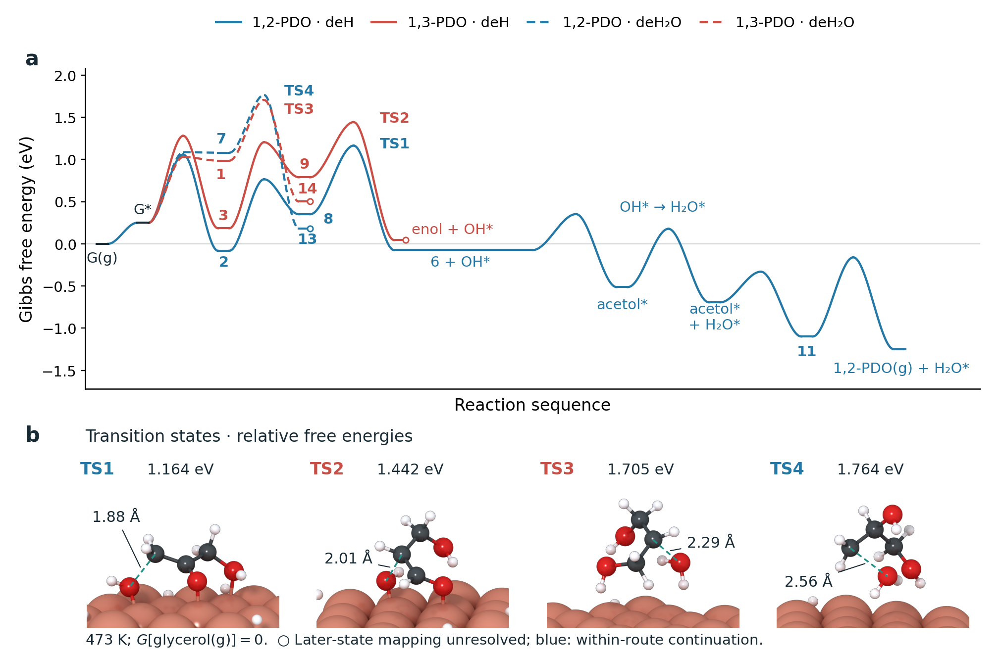</p>

能量路径与四个真实坐标 TS 同时呈现，各自承担不同证据角色。后期映射未解决的路径保留空心终点；导引线不能冒充连续 PES 计算，原子距离也不单独证明机理。

[能量 CSV、坐标、图形资产与代码](skills/research-harness/assets/real-data-examples/reaction-energy/) · [来源与限制](skills/research-harness/assets/real-data-examples/reaction-energy/SOURCES.md)

**目标：171 × 112 mm。** 来源 Kang et al., *Chemical Science* (2022), [10.1039/D2SC02107B](https://doi.org/10.1039/D2SC02107B)，该例的论文来源材料保留 **CC BY-NC 3.0** 非商业限制。结构是位图渲染，曲线、文字和距离标注可编辑。示例展示局部能量与结构，不宣称完整复现原反应网络。

### 06 · OVITO：纳米颗粒与载体，有材质也有来源边界

<p align="center">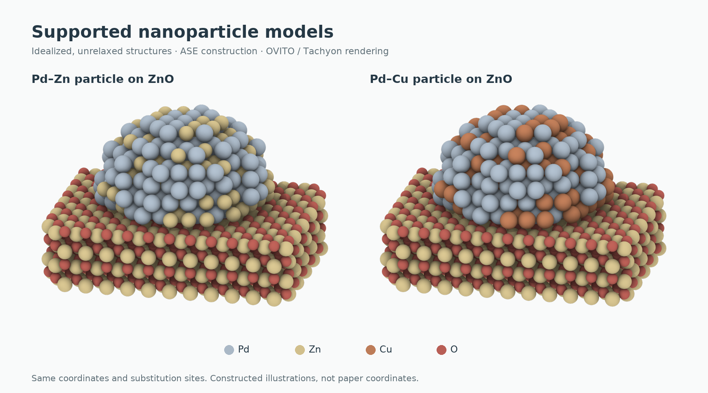</p>

密排球径、柔和环境遮蔽、低高光材质和统一正交相机，让颗粒轮廓与接触界面同时可辨。两个模型共用坐标和替换位点，仅改变指定位置的元素，避免把视角或粒形差异混入对照。

**这是 ASE 构造的未弛豫理想示意模型，不是论文坐标或实测结构。** 每个模型含 1,413 个原子；构造参数和界面间距是本例示意选择。原记录标明 OVITO 3.16.0 / Tachyon CPU / final，透明成图为 2000 × 1375；本次公开打包未重新进行三维渲染。

[透明原图、坐标、构造源码、相机和光照配置](examples/supported-nanoparticles/) · [独立 OVITO skill](skills/ovito-structure/SKILL.md)

### 07 · 完整汇报：从复杂论文到听众能跟随的讲述

**RFdiffusion · 20 页中文汇报 · 18 页主讲 + 2 页备份**

<p align="center">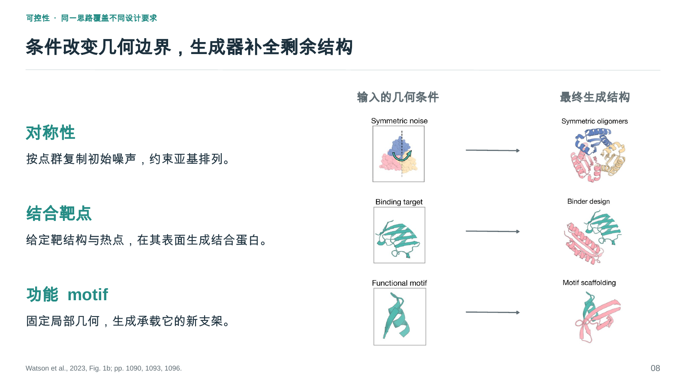</p>

<p align="center">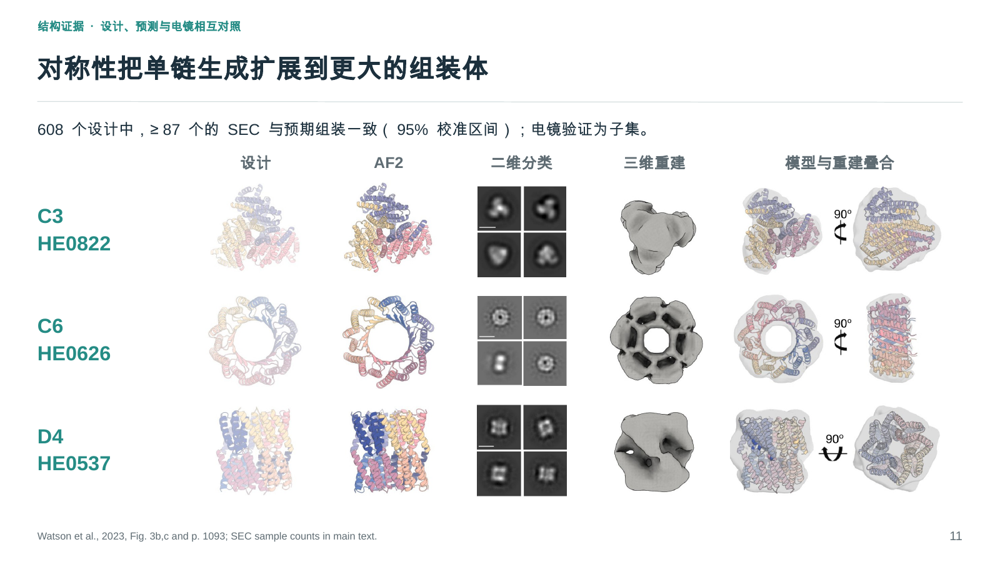</p>

方法页先建立“输入约束如何作用于生成”的理解，证据页再用相同对象逐列对照设计、预测与实验。页面承担不同的讲述任务；完整讲稿保留实验口径、分母和结论限定。

[**下载可编辑 PPTX**](examples/rfdiffusion/RFdiffusion.pptx) · [完整 PDF](examples/rfdiffusion/RFdiffusion.pdf) · [20 页预览](examples/rfdiffusion/slides/) · [页面源与素材](examples/rfdiffusion/) · [逐页讲稿](examples/rfdiffusion/speaker-notes.md)

<details>
<summary>展开整套汇报概览</summary>

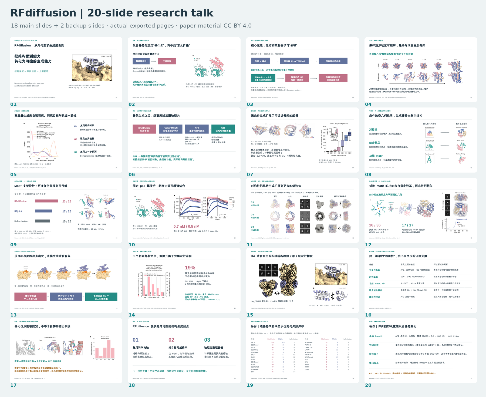

</details>

来源 Watson et al., *Nature* (2023), [10.1038/s41586-023-06415-8](https://doi.org/10.1038/s41586-023-06415-8)，论文图像与数据保留 **CC BY 4.0** 归属。标题、说明、节点与新增数据图表为 PPT 原生对象；蛋白结构和原文图像仍为位图。该展示是已有多轮自主精修后的完整汇报，不是零返工首稿，也不是重新训练或复算论文模型。

## 修改前后：为什么清楚、整齐仍不够

<p align="center">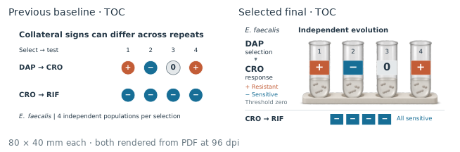</p>

旧稿能够表达符号关系，却没有形成有分量的科学主体。新稿让独立对象、身份和结果共同承担故事。有效动作是重建对象关系；它不意味着“所有 TOC 都应加写实插画”。

[三图源文件与原生尺寸检查](examples/collateral-response/) 保留可编辑入口。页面对照只是展示；不要从缩放后的网页截图推断出版时的实际可读性。

## 设计理念

### 意图先行，但不把作者的愿望当成证据

材料先进入可追溯的来源和主张记录。代理提出叙事候选、指出缺少的一跳、区分观察与解释，和作者逐步把模糊想法变成可讨论的研究逻辑。关键未知才需要人类判断；不要求作者一开始就知道画什么图。

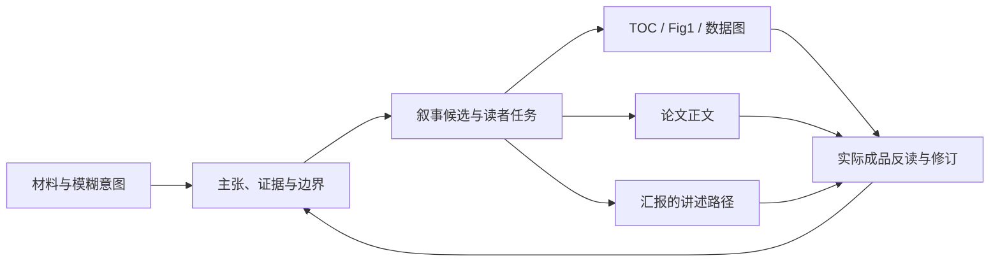

### 同一故事，分别设计表达方式

| 表达 | 读者需要完成的任务 | 设计重点 |
|---|---|---|
| TOC | 快速认识研究对象、核心作用与结果关系 | 在目标小画幅中选择一个主要事件 |
| Fig1 / 概览 | 理解研究如何成立、对象如何进入证据 | 维持身份、尺度与关键关系 |
| 数据图表 | 比较量、趋势、条件和不确定性 | 数值来源、编码、参照与误差定义 |
| 机制 / 结构图 | 理解状态变化、竞争路径或空间作用 | 科学对象、局部几何和有意义的连接 |
| 正文 | 建立可支持的论证 | 主张与证据的覆盖、限定及衔接 |
| 完整汇报 | 按听众理解顺序逐步建立判断 | 前提、方法必要性、关键证据与后段收束 |

图与 slide 共用主张和来源，**不强制共用叙述顺序或版式**。给一篇论文即可启动汇报制作，不需要先写逐页提纲；编辑性按最终载体说明，图片、SVG 源文件和 PPT 内原生对象不混为一谈。

### 这套 harness 着重解决什么

| 设计取舍 | 可检查的实现 |
|---|---|
| 从不知道画什么开始 | [故事共构](skills/research-harness/references/story-discovery.md)，来源、候选、主张及未决选择 |
| 科学对象和论证先于模板 | [科学绘图 skill](skills/scientific-figure/SKILL.md)，任务、关系与图件职责拆解 |
| 同一事实体系，多种媒介 | [跨表示关联](skills/research-harness/references/cross-representation.md)，共享 ID 与变化后复核 |
| 持续修改有明确入口 | 数据、图形语义、样式与资产分别维护；定向修改和关联检查 |
| 字体统一仍允许层次 | 字体角色、单位和化学正体、变量斜体、物理尺寸分面，而非全局一键缩放 |
| 结构不能凭图猜造 | [OVITO skill](skills/ovito-structure/SKILL.md)，真实坐标与明确授权理想模型分开 |
| 视觉质量有独立反馈 | [首稿与盲评](skills/research-harness/references/first-draft-and-blind-review.md)，保留失败稿与实质返工 |

这些是本项目的实现重点，不是对所有其他绘图工具的穷尽比较，也不是“自动优于人工设计”的结论。

## 能力与边界

支持的后端包括 paired、table、energy、energy_network、methods、series、structure3d、catalyst_surface、toc、schematic、summary 和 recipe。复杂图可用项目自己的可审阅绘图代码；共享约束连接来源和编辑入口，而不要求所有学科套同一布局。

目前更可靠的是可追溯数据、明确科学对象、定向修改及已有图式的精修。**复杂新论文的首稿审美、模糊科学关系的判断和跨领域无辅助迁移仍不稳定。** 目标尺寸、实际反读与独立评审帮助暴露失败，不能保证消除失败。公开示例是经过修订的实例，不是对任意论文的性能承诺。

程序检查关注字段、引用、数值绑定、导出与有限几何；科学判断检查主张是否得到支持；视觉审阅看故事、主次、密度、字体、材质与阅读路径。三者分别记录。

## 开始使用

### 1. 获取并准备环境

```bash
git clone https://github.com/Phorbol/research-story-harness.git
cd research-story-harness
python3 -m venv .venv
source .venv/bin/activate
python -m pip install -r requirements.txt
```

建议 Python 3.12。三维结构、参考 PDF、源 H5 提取和幻灯片的额外依赖见 [DEPENDENCIES.md](DEPENDENCIES.md)。核心工具不需要预先下载论文或模型权重；agent 宿主、模型和联网检索由使用环境提供。

### 2. 安装或直接使用 skills

```bash
# 复制到当前 Codex 用户的 skills 目录；已有同名技能会拒绝覆盖
python install_skills.py

# 或安装到自选目录；不会自动安装 Python 依赖
python install_skills.py --dest ./installed-skills
```

也可以不安装，直接让支持读取本地指引的 agent 访问 `skills/<name>/SKILL.md`。本仓库不是后台自动运行服务。

### 3. 从意图启动

> 阅读这篇论文与我的研究材料。我目前只怀疑平均误差不足以说明模型适用于研究任务。先区分材料支持什么、我希望表达什么，提出叙事候选；选定后制作 TOC、Fig1 和关键数据图，按目标尺寸反读它们是否仍在讲同一个故事。保留真实数据与缺口。

> 把这篇论文做成完整可编辑汇报。听众理解基础计算化学，但不熟悉这个方法。按听众需要重组讲述顺序，说明方法为何必要、证据如何支持结论及结论在哪里停止，并交付 PPTX、可编辑源和实际渲染后的审阅记录。

### 4. 直接运行一个真实数据例子

```bash
python skills/research-harness/assets/real-data-examples/condition-map/run.py --out ./build/condition-map
python skills/research-harness/assets/real-data-examples/reaction-energy/run.py --out ./build/reaction-energy
```

两例都能从随包数据重建 PNG / PDF / SVG。反应能量例默认使用已渲染结构资产；换坐标需要重新渲染结构并更新原子映射。

初始化新研究项目：

```bash
python skills/research-harness/scripts/research.py init ./my-study
cd my-study
# 填写来源、问题、数据与图件规格后执行
python scripts/research.py check research.json
python scripts/research.py render research.json --out build
```

仅为了解接口，可在另一空目录使用 `init --demo`；其数据明确为合成示例，不能当作科学结果。

## 11 个协作 skills

| Skill | 职责 |
|---|---|
| [source-harvester](skills/source-harvester/SKILL.md) | 收集来源、范例与适用边界 |
| [paper-dissector](skills/paper-dissector/SKILL.md) | 拆解论文的论证和图表任务 |
| [argument-architect](skills/argument-architect/SKILL.md) | 建立可追溯主张、贡献与故事候选 |
| [context-pack-builder](skills/context-pack-builder/SKILL.md) | 组织期刊、领域和研究设计上下文 |
| [academic-writing](skills/academic-writing/SKILL.md) | 科研写作入口与协作 |
| [manuscript-editor](skills/manuscript-editor/SKILL.md) | 起草、重构与候选修订 |
| [manuscript-auditor](skills/manuscript-auditor/SKILL.md) | 核对支持关系与修订引入的问题 |
| [scientific-figure](skills/scientific-figure/SKILL.md) | 从科学任务设计图形语言 |
| [research-harness](skills/research-harness/SKILL.md) | 项目状态、渲染、定向修改与检查 |
| [ovito-structure](skills/ovito-structure/SKILL.md) | 原子、晶体、表面与颗粒渲染 |
| [ansatz-slide](skills/ansatz-slide/SKILL.md) | 从论文到完整可编辑学术汇报 |

按任务使用相应入口，不要求每次全套执行。Slide 实现基于 [ansatzX/ansatz-slides](https://github.com/ansatzX/ansatz-slides) 的固定 MIT 版本；本项目增加共享科研故事与汇报组织方法，保留上游归属和修改记录。

## 运行验证、许可与贡献

- [验证记录](VERIFICATION.md)：在独立公开目录实际运行的检查、环境与未覆盖项。测试通过不代表图形已达到发表级。
- [完整设计文档](design/HARNESS-DESIGN.md)：状态、角色、数据契约、反馈路径和边界。
- [依赖](DEPENDENCIES.md)：按所需后端安装，避免把本机环境当成可移植保证。
- [第三方归属](THIRD_PARTY_NOTICES.md)：MIT 上游、CC BY 与 CC BY-NC 数据的不同适用范围。

改进建议最好带上最小可分享材料、希望读者理解什么、目标尺寸、当前成图及具体失效位置。新图式应保留来源与适用条件；不要只追加一条“更美观”的规则，也不要把一次修订成功泛化成跨领域保证。

---

**English summary.** Research Story Harness connects research intent, evidence, argument and scientific objects to editable figures, manuscripts and presentations. It packages eleven cooperating skills, executable rendering tools, reusable components and source-backed examples. Figure design starts from the reader's task; a talk reorganizes the same evidence for an audience rather than copying paper order. First drafts and substantive revisions are kept distinct. Automated checks do not certify scientific correctness or publication quality. Third-party licenses apply per asset; no blanket first-party open-source license has been assigned.
