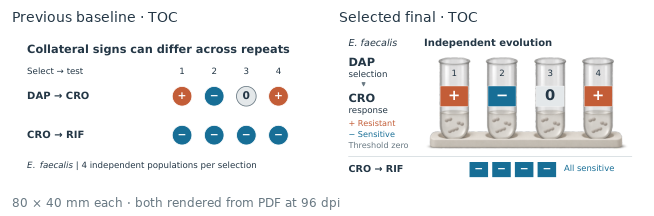
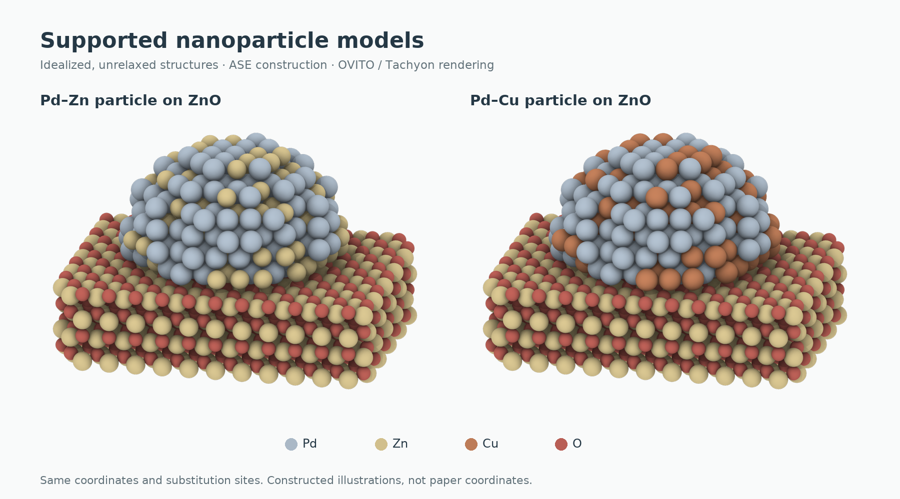

# 把判断留给 Agent，把可靠性做进环境

**Research Story Harness 的设计模式、取舍与尚未解决的问题**

给一个 agent 论文、数据和绘图工具，它通常能够生成一些看起来像科研成果的文件。但真正困难的工作发生在文件之外：作者还没有想清楚想表达什么；几种解释都说得通；一张漂亮的图可能让读者得出过强的结论；修改一处数据以后，汇报里的旧数字依然存在；自评说“通过”，实际成图却仍然只是整齐的草稿。

这些问题不能全靠换一个绘图库解决，也不能仅靠更长的提示词解决。它们涉及一个 agent 如何理解任务、保存判断、调用工具、接受反馈，以及在多轮工作后继续对同一件事负责。

Research Story Harness 是我们对这一问题的一次具体实践。它以科研写作、论文图和学术汇报为工作场景，将按需读取的 skills、本地脚本、来源与主张记录、可编辑产物和审阅方法组合起来。设计目标是让复杂任务中的判断能够被提出、检查、修正并继续使用，而不是让每一轮都从一段聊天中重新猜测全部背景。

本文分析的是这套系统的 agent 方法论。现有仓库是一个由宿主 agent 驱动的工作环境，尚不是自动调度全部步骤的独立服务。下文会区分已经落实到代码的机制、需要 agent 执行的工作约定，以及仍待实验检验的设计假设。

## 1. 为什么把“判断”作为设计对象

一种直接的设计方式是按产物组织能力：一个 skill 画图，一个 skill 写文章，一个 skill 做 PPT。这样的入口容易理解，但如果各自独立解释材料，多个产物就可能在不知不觉中讲不同的故事。

例如，“模型在这个测试集上的平均误差较低”与“模型适合用来研究这个材料问题”不是同一个判断。前者可以由误差统计支持；后者还可能需要检验决定研究结论的结构、能垒、动力学或其他物理行为。若 agent 在生成 TOC 时把前者压缩成“可靠研究工具”，下游即使字体、数字和文件格式全部正确，表达仍然发生了实质变化。

因此，我们把任务的核心对象放在“当前希望读者形成什么判断，以及材料能够支持到哪里”上。图、正文和 slide 都是围绕这个判断组织的表示。这个选择改变了整个系统的工作顺序：在决定版式之前，先区分作者意图、来源观察、来源作者的解释和 agent 自己的推断；在评价成品时，也不能只问文件是否生成，还要问读者究竟会理解成什么。

这不是要求人类一开始就写出完整论证。恰恰相反，agent 的价值之一，就是把模糊想法转成可以争论的候选解释。用户说“平均误差低好像还不够”，agent 应先寻找材料中可能改变判断的对照，提出“平均性能”“任务适用性”“失效条件”等不同侧重，说明各自依赖什么证据。让人选择和修正具体解释，比反复要求人回答“你到底想讲什么故事”更有效。

当前的[故事共构方法](../skills/research-harness/references/story-discovery.md)将这种协作落在候选、读者问题、来源观察和真实反馈上。[story.py](../skills/research-harness/scripts/story.py)检查记录的关联与声明一致性；它不会替模型读论文，也不能证实记录中的一句“用户同意”真的发生过。这里已经体现了第一项重要分工：程序保存可检查的关系，宿主 agent 对理解和交互负责。

## 2. Harness 的作用：为开放判断提供稳定环境

在这个项目里，skill 是一份有明确适用范围的工作指导，tool 执行具体操作，workflow 描述常见的推进方式；harness 则把它们与项目状态、产物和反馈连接起来。几个概念有重叠，但责任不同。

一个渲染脚本可以把坐标变成图片，却不知道应该强调界面还是颗粒形貌。一个 skill 可以提醒 agent 保留结论边界，却不能保证最终 slide 没有把限定删掉。一个固定 workflow 可以安排“阅读—规划—绘制—检查”，却无法仅凭顺序决定什么时候应该回到原文重读。Harness 要提供的是让这些判断有依据、有落点、可以返回修改的环境。

我们采用的设计可以概括为：**让模型处理需要语境的判断，让程序处理边界明确、能够重复检查的约束。**

| 工作 | 主要承担者 | 原因 |
|---|---|---|
| 理解论文问题，比较故事候选，发现解释缺口 | agent，并在关键意图处与人协作 | 需要领域语境和开放推理 |
| 检查引用 ID、输入文件、字段和登记依赖 | 程序 | 规则可以明确描述并重复执行 |
| 生成图形、渲染结构、导出可编辑 PPTX | 对应工具或后端 | 将确定的制作操作交给专门实现 |
| 判断主张是否受支持、图是否误导、讲述是否连贯 | 回到材料和成品的审阅者 | 不能从字段齐全推导出来 |
| 检查旧审阅是否仍绑定当前输入 | 程序 | 版本变化是可观测事件 |

这项分工借鉴了 [ansatz-slide](https://github.com/ansatzX/ansatz-slides) 对模型视觉判断与程序字段、几何、版本检查的区分。本仓库保留固定版本的上游运行时，并在外层增加研究故事与来源关联；[provenance.json](../skills/ansatz-slide/provenance.json)记录了来源和修改范围。

分工也有代价。如果程序限制过少，agent 可能在看似顺畅的生成中破坏数据关系；如果把一切都写成硬规则，系统又会奖励“满足表单”而非完成研究表达。我们选择只对已有明确判据的部分实施程序检查，其余部分保留为需要真实观察的判断，而不伪装成已经自动验证。

## 3. 显式状态：把记忆变成可以修订的工作对象

长任务的困难不只是上下文长度。即使聊天记录没有丢失，里面也混合着临时假设、被否定的方案、作者决定、执行日志和旧版本结果。让 agent 每次都从聊天中重建“当前事实”，容易把过去的推测当成已确认状态。

因此，harness 将重要工作状态外置。在图件项目中，`research.json`连接来源、数据、主张、科学对象、关系和图件；`story.json`保留候选、材料观察、作者决定与未决选择。写作状态库进一步区分 source、evidence、claim、plan 与正文 unit，并保存审阅依赖。[项目设计说明](HARNESS-DESIGN.md)与[写作共享契约](../skills/argument-architect/references/contract.md)给出了具体结构。

这是一种“对话用于协商，项目记录用于交接”的设计。记录不需要复述全部对话，只保存继续工作和重新判断所需的事实、定位、决定及缺口。好的记录应使接手者能够回答：这句话从哪里来，经过了什么解释，当前支持到什么程度，修改它会影响哪些产物。

外置状态也会产生新的风险：写进 JSON 的内容看起来比自然语言更确定。为避免这种错觉，状态必须能够表达未知、部分支持和未评价。写作契约中的 `stale` 表示旧判断的依赖已经变化，不表示该判断已被反驳；`supported`则是提交的语义审阅结论，不是程序证明了科学事实。图件工具同样保留 `unknown` 和 `not_implemented`，不会把没有能力检查的部分自动算作通过。

另一个风险是出现多份互相竞争的事实库。我们的约定是：已有写作主张库时，故事文件作为视觉讨论和探索视图复用其 ID，不再建立另一套“已经支持”的科学结论。这个约束目前主要依靠使用方法和关联检查执行，尚不是覆盖全部状态的一体化数据库。

显式状态的价值，是降低上下文丢失和多轮修改的歧义；它不能让错误记录自动变真，也不能替代持续读源。

## 4. 从语义到表示：一种受约束的编译思路

把研究意图“编译”成图形语言，是一个有用的设计比喻，但不能按字面理解。自然语言意图没有完整形式语义，当前系统也无法证明一个图与作者意图等价。这个比喻真正有用的部分，是引入中间表示，并让转换过程可以被检查。

我们的中间表示不是像素，也不是最终页面，而是主张、证据、科学对象、关系和读者任务。例如，“让读者比较四个独立群体在同一选择条件下的不同响应”，已经比“做一张好看的 Fig1”具体得多，但还没有锁死布局。它允许使用对象排列、方向矩阵、局部数值或其他合适表达，同时保留不能改变的比较单位。

公开的[旁系响应示例](../examples/collateral-response/README.md)展示了这种分离。TOC压缩出同一选择条件下结果可能不同的对比；Fig1让实验单位贯穿群体、分离株和测试药物；数据图则展示更大的关系集合与可核查的局部数值。同一材料进入三种产物，各自承担不同的读者任务。

*这组前后图说明可以在不更改数据的前提下改写视觉表达。它不是随机对照实验，不能凭一组图证明某种风格普遍更好。*

这种思路也解释了为什么论文图不能直接缩成 slide。论文图允许读者来回比较，汇报则必须按时间建立理解。两者应该保留同一主张及其成立条件，却可以采用不同顺序。共享事实而允许不同叙述路径，比强制“一张图一页”更接近真实任务。

这里采用的是“共享语义，分别投影”的设计模式。它的收益是减少事实漂移，同时保留媒介适配的自由。代价是转换仍然需要设计：图件到汇报不是纯格式转换，颜色相同、claim ID相同、数字相同，都不能证明听众得到了同一个判断。

## 5. Skill 的边界按决策职责划分，而不是按代理人数划分

面对复杂任务，很容易把每个阶段都变成一个独立 agent：阅读、规划、审美、绘图、评审各一个。这样画出的系统架构很清楚，但交接本身也会丢失语境，多个 agent 还可能重复解释同一材料。

我们的 11 个 skills 首先是职责模块，不是默认需要启动的 11 个进程。`paper-dissector`负责拆解原文如何建立论证；`argument-architect`组织主张与证据；`scientific-figure`决定图件如何表达；`ovito-structure`处理坐标、显示参数和结构渲染；`ansatz-slide`组织汇报及可编辑页面。一个宿主 agent 可以按任务依次使用这些能力。

这个选择的依据是：分离不同的决策问题有价值，但分离执行上下文不一定总有价值。需要独立盲读或明确的迁移实验时，独立上下文可以减少制作者解释的影响；只是调整一个标签时，再创建规划者和评审者通常增加成本，却未必增加信息。

相应地，skill 的入口应说明何时使用、什么时候可以跳过、输入输出是什么，再把复杂参考放在按需读取的文档中。局部润色不应被迫初始化完整论证库；只渲染已有坐标也不需要重新讨论论文故事。这样的组织试图控制上下文负担，但我们尚未做受控测量来证明它降低了多少 token、时间或返工。

目前文档仍然存在跨文件重复和历史经验积累较多的问题。按需加载是设计方向，不等于上下文管理已经最优。继续优化时，更有价值的是删去不会改变动作的重复提醒，而不是无限增加入口规则。

## 6. 用专门后端保持精确性，用开放接口保留表达空间

如果所有图都通过同一套通用方框组件生成，结构图、反应网络、统计比较最后很容易长得相似。问题不只在审美：同一种几何语言可能掩盖不同科学关系。

我们将科学对象与显示实现分开。真实坐标进入结构后端；定量数组进入数据图；状态、分支和假设进入相应关系场景。对于内置图型不适合的情况，允许项目编写可审阅的 `recipe`，继续使用来源关联、样式和导出检查，而不强迫材料适配某个固定模板。

这种扩展方式提供了表达空间，也扩大了需要审阅的代码范围。当前 recipe 可执行本机 Python，并非安全隔离的插件环境；系统也无法因为它成功输出一张图，就知道统计计算或科学含义是否正确。这是明确的工程边界，不能用“通用后端”掩盖。

结构渲染可以更直观地说明这种设计。公开的[负载颗粒示例](../examples/supported-nanoparticles/README.md)使用明确标注的 ASE 理想模型，两份结构共享坐标和相机，只改变选定位点的元素。原子半径、材质和光照是显示参数，不应悄悄改写坐标身份。这个例子展示了如何控制比较条件，并不证明构造模型对应某篇论文的真实结构。

*结构是未弛豫的理想示意模型。坐标来源与显示配置分开保存，目的是让编辑者知道哪些可以为阅读效果调整，哪些属于科学输入。*

可编辑性也必须具体到层。原生文字和数据曲线可以局部修改，不代表嵌入的论文图或结构位图也能在 PowerPoint 中逐原子编辑。把编辑边界说清楚，是工具契约的一部分。

## 7. 增量修改：约束修改范围，并让旧判断及时失效

一次生成不是科研表达的常态。用户会要求换配色、增大球径、调整证据顺序、补一个过渡态，或者收紧结论。把这些都处理成“重新生成一遍”，会使已经正确的部分在每轮再次暴露于变化。

图件工具中的 `revise` 区分 presentation、interpretive 和 data 修改。操作声明允许改变的位置和需要保留的值；程序从旧状态取得保护值，先构造候选并检查，接受后再保存历史。它的设计意图是让局部修改能够回答“这次改变了什么，哪些内容应保持不变”。具体行为见 [research.py](../skills/research-harness/scripts/research.py) 的 `revise`。

这里不能夸大保证。字段分类约束的是已登记路径，不会理解任意绘图代码，也无法从一段标题字符串自动判断结论是否变强。因此，程序保护需要与实际差异阅读共同使用。

另一项机制是让旧审阅过期。输入、数据或源码改变以后，旧图即使还存在，也不能因为昨天被看过就继续视为当前版本已审阅。[representations.py](../skills/research-harness/scripts/representations.py)记录共享输入与各产物依赖的文件指纹，变化后返回需要复核的状态。

这借用了构建系统的依赖思路，但当前实现是保守的文件变化检查：共享文件变化可能使多个表示一起需要复核；它不会自动定位发生变化的句子，不会自动重画，也不会判断修改是否影响结论。增加指纹在这里有具体用途——防止旧评审绑定新产物——而不是以哈希值证明内容可信。

长期工作需要这样的失效机制。只保存“通过”而不保存通过所针对的版本，会让一次正确审阅逐渐变成错误的信任来源。

## 8. 反馈应作用于错误所在的层

模型很擅长解释自己为什么做得合理。如果制作和评价使用同一套预设故事，模型还可能把图里没有表达出来的意思补读进去。这是我们反复遇到“逻辑能读懂，却远未达到正式成品质量”的一个可能原因；它需要实际成品观察，而不能只靠更严格的自评措辞纠正。

因此，反馈分为不同层：程序检查字段和有限几何；科学审阅回到来源核对对象、条件和结论；读者审阅尝试从成品恢复故事；视觉审阅检查主次、密度、字体、材质、遮挡及阅读路径。某一层通过不能抵消另一层的问题。

这个思路与 Munzner 的可视化嵌套模型相契合：领域任务、数据与操作抽象、视觉编码、算法实现具有不同的验证问题，上游错误会影响下游。[原论文摘要](https://www.cs.ubc.ca/labs/imager/tr/2009/NestedModel/)支持这种分层认识。将它用于 agent 工作环境，是本项目的设计解释，并非原论文直接验证过我们的实现。

例如，热图和表格混淆，首先要检查读者需要精确查值还是发现模式；能量图中缺失的后段路径，先检查来源与状态映射；TOC在80×40 mm下看不清，先检查信息选择与视觉层级。分别回到任务、证据和编码层，比一律调整配色更有可能解决问题。

程序能够防止一些自相矛盾的评审记录。`visual_review_consistency`会拒绝“整体通过，但仍声明存在未解决阻断问题”这类记录。然而它不能验证评阅者是否认真看过，也不能根据填写的形容词判断图是否美观。这个检查约束的是报告一致性，不是自动审美认证。

实际尺寸则是反馈环境的重要部分。放大预览可以用于诊断局部，最终仍需回到目标尺寸检查。在大画布上可读的字缩小后可能失效，结构之间的间距和细线也会改变。80×40 mm是某个TOC用途的具体前提，不是通用图件默认值。教材可以提供准确表达与专业呈现的原则，例如 Wilke 的 [Fundamentals of Data Visualization](https://clauswilke.com/dataviz/)；原则需要转换为当前任务的选择，再由成品检验，不能替代检查。

## 9. 人机协作不是每一步都让用户确认

一种谨慎但低效的系统会把所有不确定性都变成问题：主题是什么、故事是什么、画几张、选什么颜色、用什么布局。这样既增加打断，也把最需要 agent 帮忙的判断退回给了人。

我们的取舍是区分意图不确定性与执行不确定性。前者可能改变研究要强调什么，值得通过具体候选让人纠正；后者往往可以由 agent 根据已知目标自主处理。选择一个合理字号与替作者决定研究结论，属于不同性质的行动。

在人类尚未决定主线时，agent 可以保留候选，继续制作可逆草图和整理证据；不能把自己推荐的方案登记为作者已选择。已有明确意图时，也不应为同一个决定反复请求确认。人类选择了一个故事，只说明这是希望探索或表达的方向，仍不等于证据足以支持它。

这使协作更像共同建模：agent把模糊意见变成具体、可反对的判断，人通过纠正逐步明确意图，系统保留改变的理由。真正要优化的是获得决策相关信息的效率，而不是单纯减少提问次数或增加自动化比例。

## 10. 独立迁移实验检验什么

经过许多轮精修的一张好图，说明我们能够把这一张图修好。它不能直接说明另一位 agent 加载相同 harness 后，也能独立处理一篇新论文。

为了分开这两种能力，[独立迁移方法](../skills/research-harness/references/independent-transfer.md)要求在实验开始前冻结方法，制作方只接收原材料、模糊意图、交付规格与环境信息。主代理如果直接给出故事、关键数值或布局，测试的就变成执行已有答案的能力。共享文件环境也不等于隔离；应记录真实输入边界，而不是宣称绝不可能接触其他答案。

首份完整成品应原样保存，不能在多轮自修后把最新版本追称为首稿。首稿前的试页重排、证据改选和关键裁切同样可能构成实质返工。若只比较交付后的修改轮数，系统可以通过把工作移到“首稿之前”制造效率提升的表象。

盲读也有具体含义：先让评阅者只看成图、正常图注或完整汇报，记录读出的主张，再开放预设故事和论文核源。否则评阅者可能借助作者解释补齐图面缺失的信息。相同模型的另一个上下文可以形成不同的阅读视角，但不等于独立领域专家，也不能保证偏差不相关。

有意义的结果至少要分开首稿、自主修订后稿与外部帮助后稿。主代理手工救场可以完成用户交付，却不能被记成独立迁移成功。修正后的满意案例值得保留，但首稿失败、审阅误判和返工成本也应该留在证据中。

目前公开仓库包含可运行组件、实际成图和有范围的检查记录；它尚不支持“跨领域稳定首稿发表级”或“显著减少总返工”的量化结论。更可信的下一步，是预先选定任务差异较大的材料，在统一口径下比较这些阶段，而不是继续累积最好看的最终图片。

## 11. 从失败中学到方法，而不是学到固定版式

一个迭代中的 harness 很容易把每次批评都变成新规则。“这页太满”变成每页只能放几个元素；“三列太单调”变成永远不能三列；“结构球太小”变成全部结构统一增大半径。规则越多，系统可能越像对历史案例的过拟合。

更合理的沉淀单位是：发生了什么失败，可能原因是什么，采取了什么动作，在哪种任务和条件下改善了什么，还有哪些替代解释。由此保存的应是带适用条件的制作方法和组件，而不是永久审美命令。

例如，RFdiffusion 汇报的制作经验支持在复杂图组中先辨认比较单位，再决定裁框，并提前试读理解依赖最多的连续页面。它不支持把所有论文做成相同列数或同样页序。[首稿与盲评指南](../skills/research-harness/references/first-draft-and-blind-review.md)将这个适用范围写得很具体。结构示例支持共享相机和来源明确的显示参数；它不要求所有机制图都增加三维球棍。

这里的“学习”主要仍是维护者根据成品反馈修改技能、组件与示例，并不是系统会自动从成功作品训练出稳定审美。未来如果要更自动化，也应先解决经验归属、反例和撤回机制，否则自动积累可能只是更快地固化偶然选择。

我们希望通用的是提问方式、来源关系、表示分离、修改边界和验收方法。至于一张图用环形、分支、矩阵还是结构放大，应由新的材料和读者任务决定。

## 12. 这套设计的优势、成本与演进方向

从 agent 工程看，本项目的特色不是某一种独有算法，而是把开放推理与可修订产物放在同一条工作链里：从不完整意图开始，保留证据和候选；按需使用专门能力；围绕共享科学状态生成不同表示；修改后使旧审阅失效；再从真实成品检查读者理解是否偏离。

这种组合适合长期、多产物、需要追溯和连续修改的工作。它也有明显成本：维护状态需要额外工作，来源关联可能遗漏，领域判断依赖模型与研究者，审美仍需实际观察；过多文档会增加上下文负担，复杂后端和 Office、OVITO 等环境也增加安装与重建成本。对于一次性的低风险小图，完整链路可能过重，应允许直接使用局部 skill。

目前我们更有把握的是一些工程机制确实存在：项目初始化、来源与对象关联、有限约束检查、定向修改、版本绑定、可编辑导出与公开数据重建。它们的检查记录见 [VERIFICATION.md](../VERIFICATION.md)。这些证据没有覆盖“所有新材料都能稳定产生优秀首稿”，也没有证明相较其他 harness 的时间或质量优势。

因此，下一阶段应优先改善三个具体问题。首先，使中间状态更精简，减少多个文件重复记录相同事实，同时保留返回来源的能力。其次，把首稿前最有区分力的观察前移，例如复杂裁片、听众前提和真实尺寸的主视觉，而不是让 agent 在最后一次性自评全部内容。最后，建立可比较的迁移记录，将首稿质量、实质返工、人工内容帮助和最终质量分别报告，并保留不成功的任务。

一个好的 harness 不能保证 agent 永远判断正确。它应让必要的判断更容易发生，让错误更容易被观察和定位，让修正能够作用于正确层级，并使已经完成的工作可以可靠地接续。对 Research Story Harness 而言，真正需要持续检验的是：这些设计是否让 agent 在新的材料面前更早发现误解、更少破坏已有结论，并最终交付研究者愿意使用的表达。

---

本文依据当前公开仓库的实现与示例撰写。示例反映特定材料和修订过程，不构成统一基准成绩。第一方代码与文档采用 [Apache-2.0](../LICENSE)；第三方运行时、论文图像和数据按[各自许可](../THIRD_PARTY_NOTICES.md)使用。
