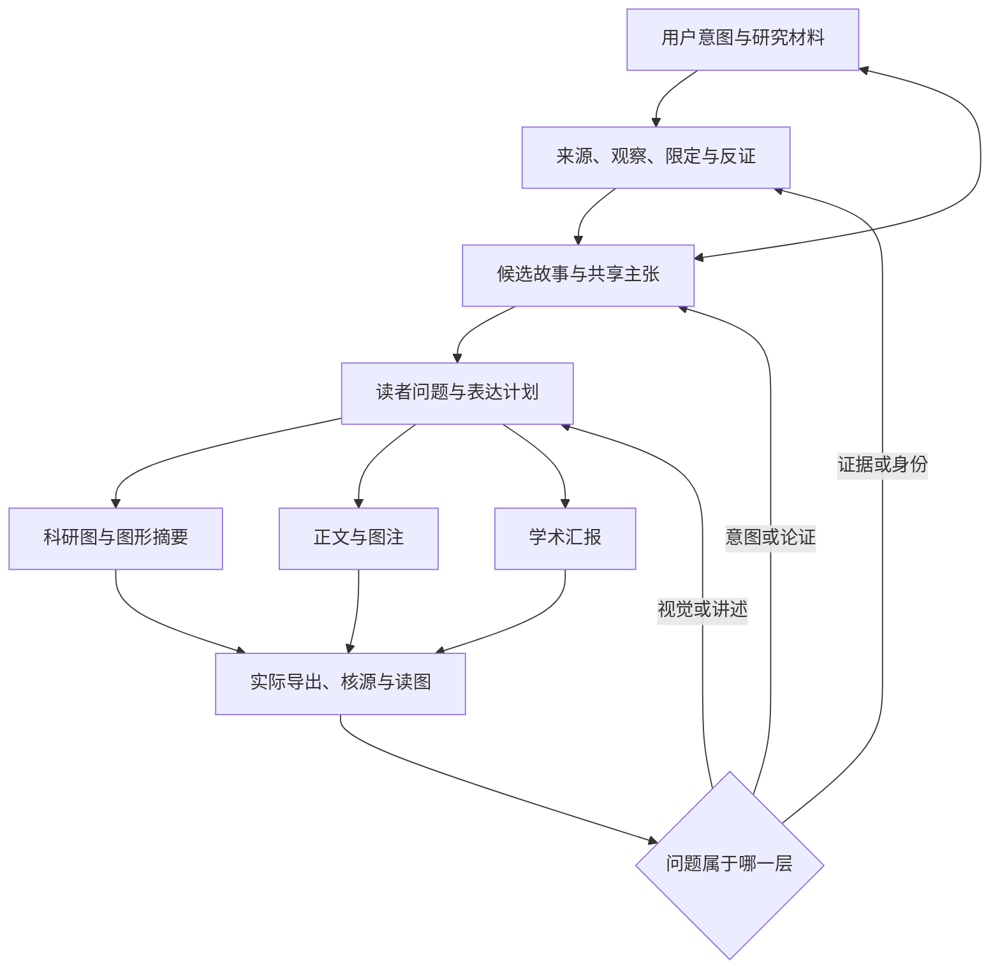

# 科研故事、写作与视觉生产：公共设计说明

本套件帮助研究者从材料、零散意图与疑问出发，建立有证据边界的故事，并将共享主张表达为正文、图件或完整学术汇报。它由按需使用的 agent skills、可执行本地脚本和可编辑资源组成；脚本不自行理解论文或决定科学结论。

设计动机、替代方案与工程取舍见[Agent / Harness 方法论长文](AGENT-HARNESS-METHODOLOGY.zh-CN.md)。

## 从材料到读者判断

先弄清材料支持什么、用户希望读者理解什么，以及还存在哪些替代解释，再选择图种、段落和讲述顺序。作者不需要先准备完整故事大纲或逐页提纲。代理可提出具体候选并解释取舍；代理假设和真实作者选择需要分别记录。



## 分工与状态

| 层 | 主要组件 | 保存什么 |
|---|---|---|
| 来源与阅读 | source-harvester、paper-dissector | 原始版本、定位、可访问范围、观察与推断 |
| 论证与写作 | argument-architect、context-pack-builder、manuscript-editor、manuscript-auditor、academic-writing | 主张、支持范围、段落、候选补丁和审阅依赖 |
| 图件项目 | research-harness、scientific-figure | 数据、科学对象、关系、面板任务、尺寸和可追溯导出 |
| 结构显示 | ovito-structure | 真实坐标或明确合成模型、占据率、显示变换与投影 |
| 汇报出口 | ansatz-slide | 页面源稿、讲述顺序、来源定位和可编辑 PPTX |

`research.json` 连接 sources/datasets、claims/sections、entities/relations 和 figures。`story.json` 保存候选、材料观察、用户决定与未决事项。写作 harness 在项目 `.academic/` 中保留版本与候选补丁。原始研究文件独立保存，不写入安装的 skill 目录。

同一来源与主张可以有不同媒介表达。科研图强调一次可检查比较；图形摘要浓缩认识变化；正文展开条件和推理；汇报按听众可跟随的顺序展开。媒介间不复制成互不相干的新事实库。

## 实现原则

- 科学身份与显示决定分离。修改半径、相机、颜色和布局不应改变真实坐标、数值、单位、占据率或来源身份。
- 类型化关系说明箭头意味着数据流、比较、时间、转变或假设；不因箭头画得顺畅就推定因果。
- 图、图注、正文与主张同步修改。保留稳定 ID，并在来源或解释变化后重新审阅受影响输出。
- 领域规则按任务读取。密排表面、能量路径、统计误差和模型比较有不同的科学前提，不能推广成所有领域的模板。
- 模板是可编辑起点。保留合成标记，不把任一旧例的故事、配色、面板数或视觉偏好变成通用要求。
- 验证分层：程序一致性、科学支持、读者理解、视觉质量分别判断。导出成功和自动测试通过不证明论文可发表。

## 最小本地项目

从仓库根运行（Python 3.11+，依赖见根目录 requirements 文件）：

```bash
python skills/research-harness/scripts/research.py init work/my-project
python skills/research-harness/scripts/research.py init work/synthetic-demo --demo
python skills/research-harness/scripts/research.py check work/synthetic-demo/research.json
python skills/research-harness/scripts/research.py render work/synthetic-demo/research.json --out work/synthetic-demo/build
python skills/research-harness/scripts/research.py check work/synthetic-demo/research.json --export work/synthetic-demo/build
```

空项目没有研究结论，检查会保留缺口。合成 demo 测试数据绑定、可编辑导出与修订保护；它不是实际科研结果。

## 验证与限制

公开回归测试使用自包含合成输入，覆盖来源漂移、关系/对象绑定、缺失值、字体、物理画布、表面身份、叙事状态和受保护修改。它们可复现软件行为，不能替代原始材料阅读、真实读者反馈或领域专家判断。实际三维渲染还受 OVITO 版本和系统图形环境影响；幻灯片的 Office/LibreOffice 预览另需本机软件与字体。

项目数据与安装的技能保持分离，便于版本管理和更换研究材料。可运行示例、目录结构与再利用条件见[仓库内容](../RELEASE_SCOPE.md)及[许可与归属](../THIRD_PARTY_NOTICES.md)。

## 维护入口

- [研究项目契约](../skills/research-harness/references/contract.md)
- [故事发现](../skills/research-harness/references/story-discovery.md)
- [跨媒介表达](../skills/research-harness/references/cross-representation.md)
- [制作与修订循环](../skills/research-harness/references/visual-production-cycle.md)
- [从实际反馈更新方法](../skills/research-harness/references/feedback-to-practice.md)
- [写作共享契约](../skills/argument-architect/references/contract.md)
- [结构渲染](../skills/ovito-structure/SKILL.md)
- [论文到完整汇报](../skills/ansatz-slide/reference/paper-to-deck.md)

源码在仓库 `skills/`，安装目录由 install_skills.py 的 `--dest` 控制，默认采用 `CODEX_HOME/skills` 或 `~/.codex/skills`。两者不会自动同步；安装器拒绝覆盖已有技能。
