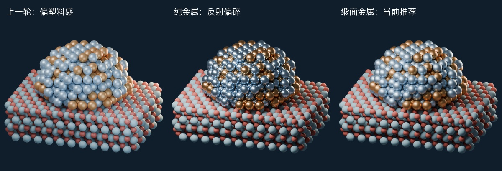
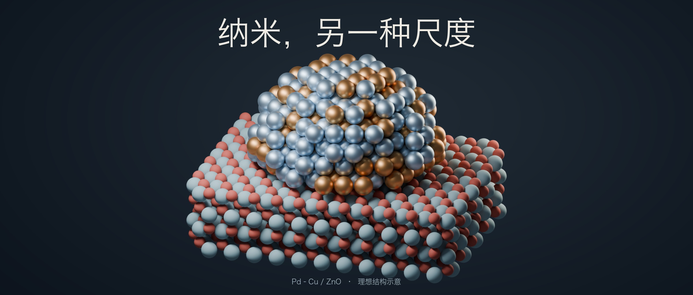
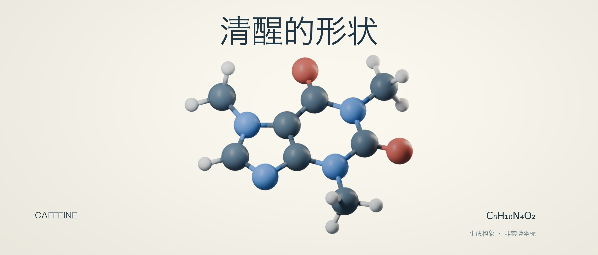
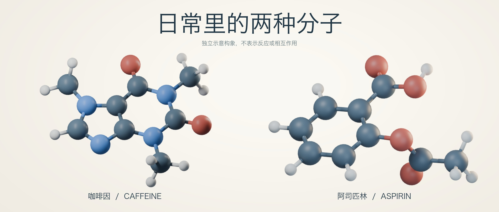
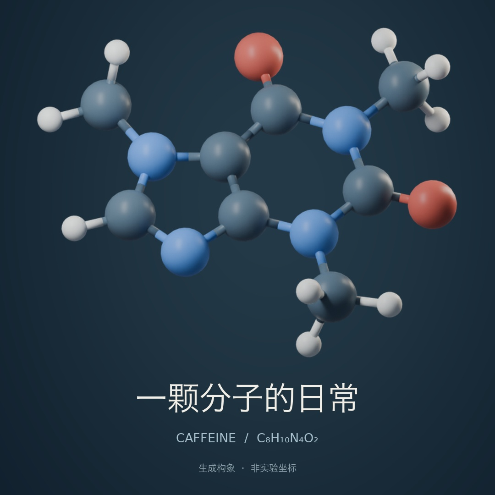
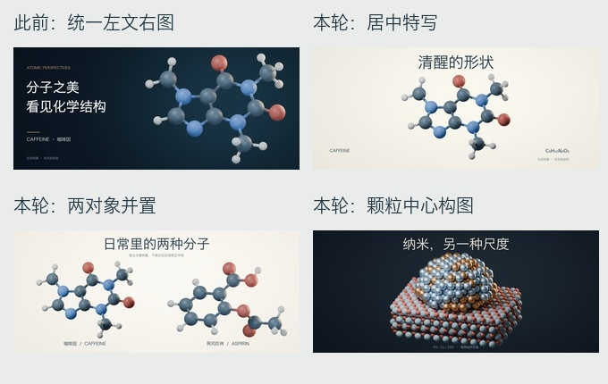

# 结构封面展厅：从原子模型到传播视觉

**[打开独立展示网站](https://research-story-harness-gallery.inwardchart4.chatgpt.site)** · [网站源码与构建](SHOWCASE.md)

[返回项目首页](../README.md) · [运行与编辑](../examples/structure-covers/README.md) · [静态 HTML 源文件](structure-covers.html)

这组图来自实际 OVITO／Blender 制作和修改。下列成图使用 Blender Cycles；材质与构图选择来自看图后的自评，不是传播效果实验。

## 01 · 材质修改：保留原子，改变光的表现

同一1413原子PdCu/ZnO理想模型，坐标、半径和相机不变。中间版本更像金属，却有密集互反射；右侧缎面版本是这次选定的折中。球体仍表示原子，不冒充连续实体表面的照片。

[金属对照配方](../examples/structure-covers/recipes/metal-strip.json) · [选定的缎面配方](../examples/structure-covers/recipes/satin-metal.json) · [完整模型来源](../examples/supported-nanoparticles/README.md)

## 02 · 实际封面：一种任务，不止一种版式

### 纳米颗粒：中心构图

[下载原图](../examples/structure-covers/covers/particle-centred.jpg) · [编辑布局](../examples/structure-covers/recipes/particle-centred.json)

### 咖啡因：单对象特写

标题只是可替换的科普封面示例，图本身不证明生理机制。[下载原图](../examples/structure-covers/covers/caffeine-centred.jpg) · [编辑布局](../examples/structure-covers/recipes/caffeine-centred.json)

### 两种日常分子：并置比较

并置不表示反应、相互作用或联合用药建议。两个结构各自保持身份与来源。[下载原图](../examples/structure-covers/covers/molecules-paired.jpg) · [编辑布局](../examples/structure-covers/recipes/molecules-paired.json)

### 方形封面：先看结构，再读标题

方形是重新组版，不是从横图中央截取。它与横版面积不同，不能把主体变大当作同条件审美胜出。[下载原图](../examples/structure-covers/covers/caffeine-square.jpg) · [编辑布局](../examples/structure-covers/recipes/caffeine-square.json)

## 03 · 手机尺寸：主角能否留下来？

居中版强调单个对象；并置版提供比较，但单个对象更小。副标题与来源限定留给大图和正文，不依赖手机缩略图承载。没有点击率测试，也没有将无碰撞等同于美观。

## 04 · 运行、修改、重新生成

[示例 README](../examples/structure-covers/README.md) 提供完整命令。快速路径使用随包的无损RGBA渲染；完整路径调用共享Blender脚本，从JSON坐标与拓扑生成透明图和`.blend`，随后按配方组版。

- 改对象：[颗粒](../examples/structure-covers/inputs/particle.json)、[咖啡因](../examples/structure-covers/inputs/caffeine.json)、[阿司匹林](../examples/structure-covers/inputs/aspirin.json)。改变科学输入需要重新核对来源，不能只改元素标签。
- 改材质和灯光：[实际配方](../examples/structure-covers/recipes/)。
- 改文字、主体位置和比例：对应布局JSON，运行后输出可编辑文字SVG、无字图与缩略图。
- 改后端实现：[渲染器](../skills/structure-cover/scripts/render_blender.py)、[组版器](../skills/structure-cover/scripts/compose_cover.py)。

**来源边界：** 颗粒为ASE理想未优化模型；两种分子为RDKit生成构象，不是实验结构。显示杆不表达键级，材质不计算光学常数。原创代码、配方及这些生成资产采用仓库Apache-2.0许可；外部工具和字体未打包，保留各自许可。未使用内部论文或第三方论文配图。
