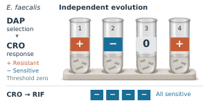
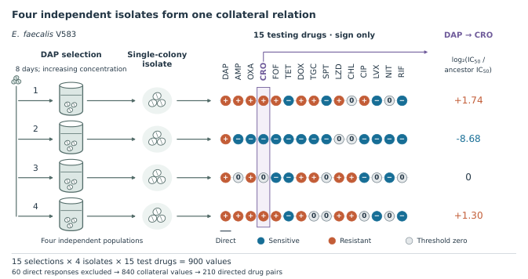
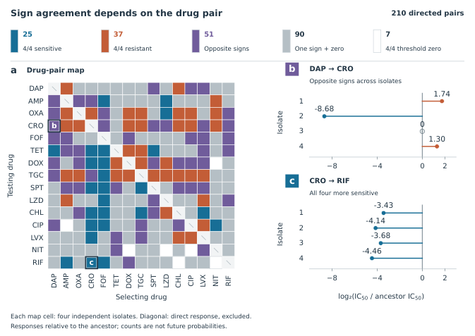

# Collateral responses across independent repeats

Three complementary figures built from the published *E. faecalis* V583 experiment of Maltas and Wood (2019). They show that independent populations evolved under the same selecting drug can have opposite collateral-response signs, and that agreement depends on the specific directed drug pair.

| Figure | Purpose | Physical size | Downloads |
|---|---|---|---|
| TOC | Four independent cultures and two contrasting drug pairs | 80 × 40 mm | [PDF](figures/TOC.pdf) · [SVG](figures/TOC.svg) · [PNG](figures/TOC.png) |
| Fig1 | Population → single-colony isolate → 15-drug sign profile | 178 × 94 mm | [PDF](figures/Fig1.pdf) · [SVG](figures/Fig1.svg) · [PNG](figures/Fig1.png) |
| Evidence | Complete directed-pair map and exact four-isolate examples | 178 × 126 mm | [PDF](figures/Evidence.pdf) · [SVG](figures/Evidence.svg) · [PNG](figures/Evidence.png) |







## Rebuild the selected figures

Use Python with the dependencies in `requirements.txt`. From this example directory:

```sh
python -m pip install -r requirements.txt
python scripts/rebuild.py TOC --out build
python scripts/rebuild.py Fig1 --out build
python scripts/rebuild.py Evidence --out build
```

Each command rebuilds only the named figure, producing PDF, editable SVG, 600 dpi PNG and a 96 dpi preview. A preview is a screen proxy, not a calibrated paper proof. The published data and illustration are bundled; rebuilding does not require network retrieval or image generation.

## Edit the scientific objects and appearance

- **TOC:** edit `toc/render-source.py` and `toc/data.json`. Its labels, identities, arrows and outcome badges remain vectors. The culture vessels, cells, stand and shadows are **one composite bitmap** in `toc/assets/four-independent-cultures.png`; they are not individually editable vector objects. The bitmap is conceptual, not microscopy or experimental evidence. The TOC renderer directly defines its typography, palette and placement.
- **Fig1:** edit `scripts/fig1.py` and the shared `style-profile.json`. All 60 directional marks have equal size; CRO remains the fourth testing-drug column. The four numerical CRO values are a separate aligned readout with their own adjacent unit.
- **Evidence:** edit `scripts/evidence.py` and the shared `style-profile.json`. The matrix, points, axes, counts and retained text are vectors. `scripts/common.py` supplies source-backed helpers; data remain in `data/`.

The normal [figure captions](captions.md) define the sampling unit, threshold zero and inference boundaries. The two illustrated drug pairs are observations, not estimates of future evolutionary success or treatment advice. The original source workbook and its full mapping are included, while the full article PDF, private workspace files, conversation records and historical reviews are excluded.

## Source and license attribution

Maltas J, Wood KB (2019), *PLOS Biology* 17(10):e3000515. [Paper](https://doi.org/10.1371/journal.pbio.3000515) · [S1 Data](https://doi.org/10.1371/journal.pbio.3000515.s017) · [CC BY 4.0 attribution and adaptation details](source/ATTRIBUTION.md).

The figure layouts are adaptations of the published data. The TOC culture illustration was newly generated and is kept separate from the editable scientific annotations.
