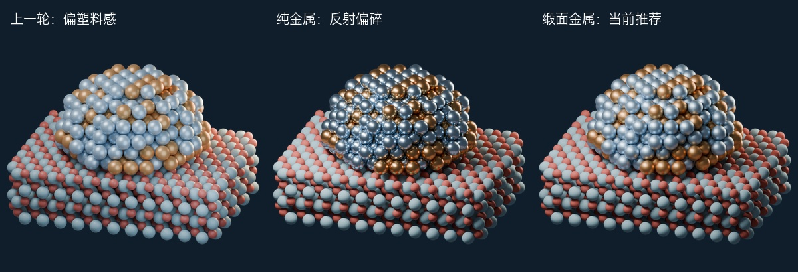
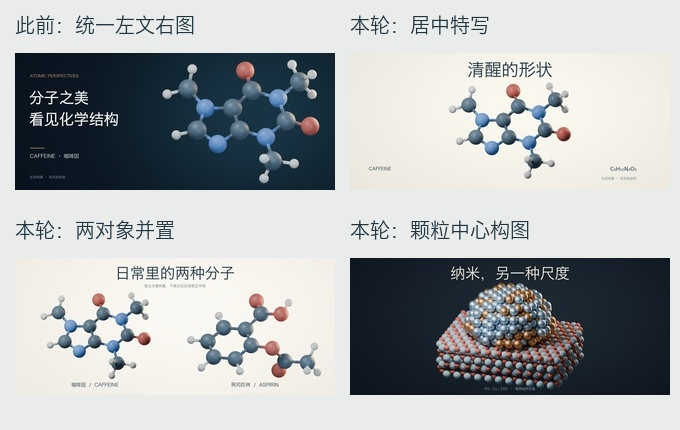

# Scientific structures as editorial covers

Actual Blender Cycles outputs, source-preserving material revisions, four layouts and phone-size comparisons. [Browse the visual gallery](../../docs/structure-covers.html).

## Material revision



Left: previous broad multi-light rendering. Middle: metallic Pd/Cu and rectangular lights, with distracting inter-reflections. Right: higher-roughness satin metal, selected for the current cover. Every particle rendering uses the same 1413 atomic coordinates, display radii and camera. Materials are illustrative display settings, not measured optical constants. This is an atomic ball model, not a nanoparticle micrograph.

## Layouts at phone size



The contact sheet keeps each wide cover at320px. Centre-led single objects, paired independent molecules and a separate square composition serve different editorial purposes; they are not all universally better than left-title/right-object layouts. Square images have a different area and must not be treated as a controlled same-aspect comparison. No click-through study or independent preference test was conducted.

| Output | Download | Editing entry |
|---|---|---|
| Centred particle | [JPEG](covers/particle-centred.jpg) | [layout](recipes/particle-centred.json), [material/light recipe](recipes/satin-metal.json) |
| Centred caffeine | [JPEG](covers/caffeine-centred.jpg) | [layout](recipes/caffeine-centred.json), [molecular material](recipes/molecule-editorial.json) |
| Caffeine + aspirin | [JPEG](covers/molecules-paired.jpg) | [layout](recipes/molecules-paired.json) |
| Square caffeine | [JPEG](covers/caffeine-square.jpg) | [layout](recipes/caffeine-square.json) |

Titles are replaceable illustrative copy. Paired molecules do not imply a reaction, interaction or co-administration recommendation.

## Run and edit

From this example directory:

```sh
python -m pip install -r requirements.txt
# Fast: use the supplied lossless transparent renders and regenerate all layouts.
python run.py --out build
# Other operating systems/fonts:
python run.py --out build --font-cjk /path/to/CJK-font.ttc --font-latin /path/to/DejaVuSans.ttf
# Full: regenerate the structures with Blender, then recompose all layouts.
python run.py --out build-full --blender /path/to/blender
```

The full route calls the shared [Blender renderer](../../skills/structure-cover/scripts/render_blender.py) and writes `.blend` scenes plus transparent PNGs. `.blend` binaries are regenerated rather than bundled; this avoids distributing workstation-specific runtime metadata. The fast route uses the supplied lossless WebP assets, decoded to the same RGBA pixels as the original PNG renders. Source coordinates, topology and all light/material settings are included.

Each layout run produces `cover.jpg`, `cover.png`, `cover.svg`, `image-only.png`, `thumbnail-320.jpg` and `composition.json`. Edit recipe text/positions or material parameters and rerun. The SVG retains editable text and embedded raster structure assets; it is not an atom-editable vector drawing. Font availability affects exact text layout, and formula subscripts require a suitable font.

## Sources and limits

- **PdCu/ZnO:** the existing [supported-nanoparticles](../supported-nanoparticles/) public example: ASE-constructed, idealized and unrelaxed; not experimental coordinates, a validated interface or a measured alloy phase. No atoms were removed or added. The complete particle scene and coordinate copy are in `inputs/`; construction provenance remains in the original example.
- **Caffeine:** C8H10N4O2,24 atoms including hydrogen. **Aspirin:** C9H8O4,21 atoms. Explicit SMILES and molecular graph → RDKit2025.9.1 ETKDGv3(seed17) → MMFF optimization → rigid PCA display orientation. These are generated illustrative conformers, not experimental structures or assertions about solution populations. The JSON scenes are the rendered orientation; MOL files preserve chemical topology in the pre-PCA rigid orientation. Display rods show connectivity rather than bond order.
- **Renders and layouts:** generated for this project. Original code, recipes and these generated assets follow the repository Apache-2.0 license. Blender, OVITO, RDKit and fonts are not redistributed and retain their own licenses. No unpublished paper, author-private structure or third-party paper figure is included.
- Sphere shading, camera, colours and apparent metal response are visual encodings. Preserved coordinates do not ensure every atom is unoccluded.

The scripts and actual render revisions were run locally with Blender4.5.0 CPU Cycles. Scientific identity checks and phone-size visual inspection are separate from aesthetic preference. See the root [verification record](../../VERIFICATION.md).
