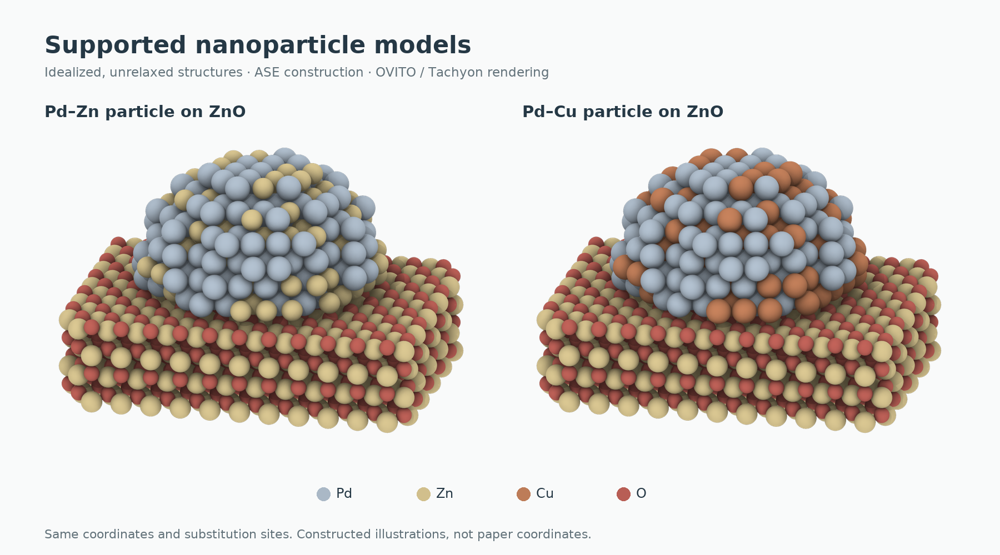

# Idealized supported nanoparticles rendered with OVITO



Two **ASE-constructed, idealized and unrelaxed** models: a Pd-containing particle with Zn or Cu substitutions, placed on a finite ZnO support. These are **not paper coordinates**, relaxed atomistic structures, microscopy reconstructions or measured alloy phases. They demonstrate a reproducible model-to-render workflow and a controlled visual comparison.

The two models share every position and particle/support tag. Only the same 128 particle sites change from Zn to Cu. A composition or phase label must not be inferred beyond the explicitly constructed model.

| Asset | Pd–Zn / ZnO | Pd–Cu / ZnO |
|---|---|---|
| Original transparent render | [PNG](renders/PdZn-ZnO.png) | [PNG](renders/PdCu-ZnO.png) |
| Complete coordinates | [extxyz](models/illustrative-PdZn-ZnO.extxyz) | [extxyz](models/illustrative-PdCu-ZnO.extxyz) |
| Recorded renderer metadata | [JSON](metadata/PdZn-render.json) | [JSON](metadata/PdCu-render.json) |

The original transparent PNGs are preserved unchanged at 2000 × 1375 pixels. The preview above only composites them on a neutral background, crops common transparent margins, applies the same scale, and adds model labels plus an element key. It does not change geometry, atom visibility or the original renders.

## Models and deliberate assumptions

Each model contains 1,413 atoms: 1,048 support atoms and 365 particle atoms. The particle has 237 Pd sites and 128 substituted sites. The ZnO support contains 524 Zn and 524 O atoms. Tags are 0 for the support and 1 for the particle; periodic boundaries are disabled.

The construction uses an fcc Pd lattice, a finite wurtzite ZnO slab, a cropped particle, a fixed random substitution pattern and a prescribed interface gap. Lattice constants, 13.5 Å crop radius, 35% substitution setting, seed 17 and 2.45 Å gap are **illustration choices for this example**, not fitted measurements, validated interface physics or scientific defaults. No adsorbates, guessed adsorption sites, interface relaxation or reaction mechanism are included. Full assumptions are in [provenance.json](provenance.json).

## Rebuild coordinates, then render

Use an environment with the dependencies in `requirements.txt`. The provided construction script keeps the original numerical construction operations and writes a separate output directory by default:

```sh
python scripts/build_models.py --out rebuilt-models
```

From this example directory in the repository, use the shared OVITO renderer. The following commands render the **provided** coordinates with the provided final camera, element colors, display radii and lighting specification:

```sh
python ../../skills/ovito-structure/scripts/structure_render.py \
  models/illustrative-PdZn-ZnO.extxyz render-spec.json \
  --out rebuilt-renders/PdZn --quality final

python ../../skills/ovito-structure/scripts/structure_render.py \
  models/illustrative-PdCu-ZnO.extxyz render-spec.json \
  --out rebuilt-renders/PdCu --quality final
```

Substitute the corresponding file under `rebuilt-models/` to render a reconstructed coordinate file. The renderer is shared repository code rather than a copied private project. The output images are raster ray tracing; they are not atom-editable SVGs. Edit the coordinate files and render specification to change scientific objects or their presentation.

To recompose the README preview from the existing PNGs, without running OVITO:

```sh
python scripts/make_preview.py
```

## What was checked

The existing scene records explicitly identify **OVITO Tachyon CPU**, **OVITO 3.16.0**, final quality, 2000 × 1375 output, 1,413 particles, the shared orthographic camera, and the recorded ambient-occlusion/antialiasing settings. The coordinate hashes match those records; both provided PNGs retain their alpha channel. The packaged metadata are labeled extracts of those original records, with source paths normalized.

This public packaging pass inspected the existing images, metadata, coordinate identity and construction-code syntax. It did **not** rerun model construction or OVITO rendering, and file presence is not presented as a fresh end-to-end test. The lightweight side-by-side composition was executed and viewed. See [PACKAGE-CHECK.json](PACKAGE-CHECK.json).

The example includes coordinates, renders, render settings and reconstruction scripts. For reuse, see the root [license](../../LICENSE) and [attribution](../../THIRD_PARTY_NOTICES.md).
