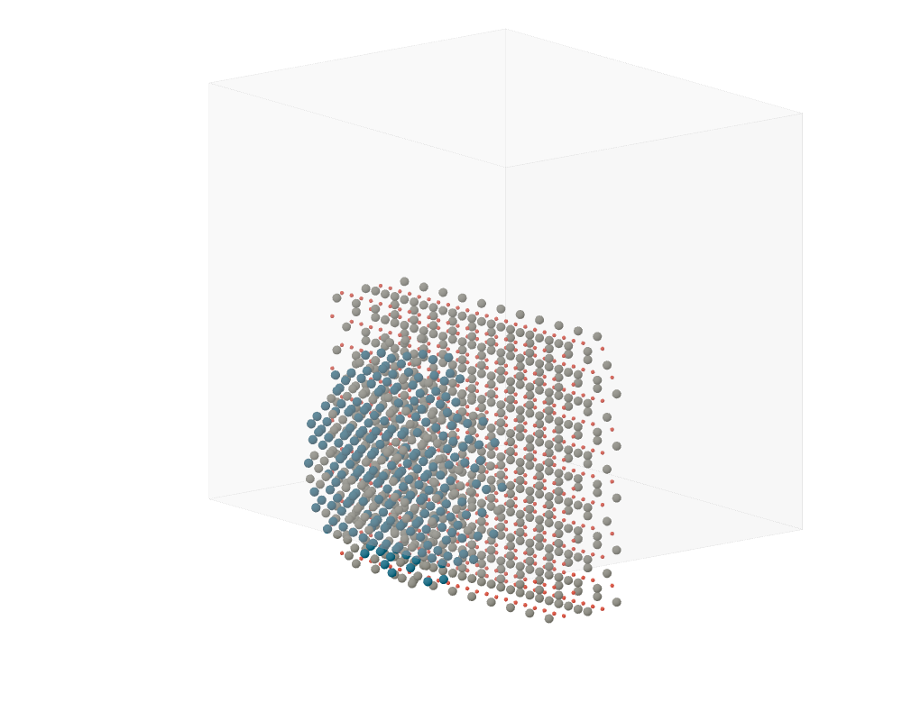
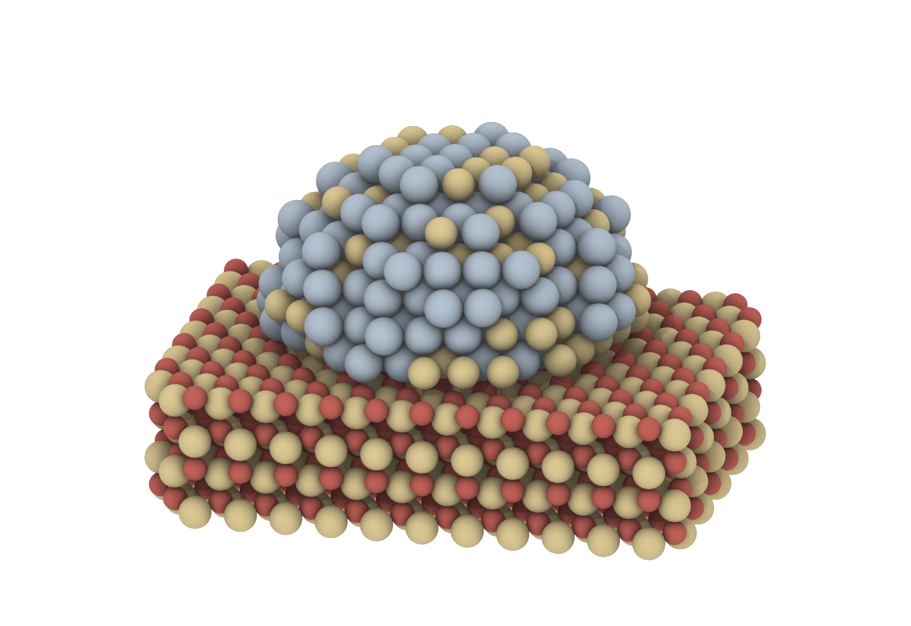
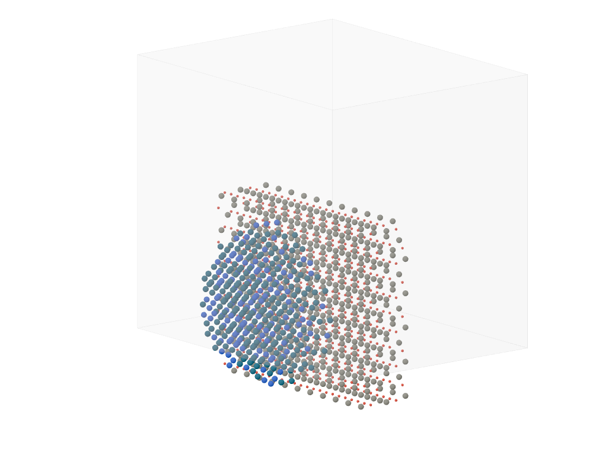
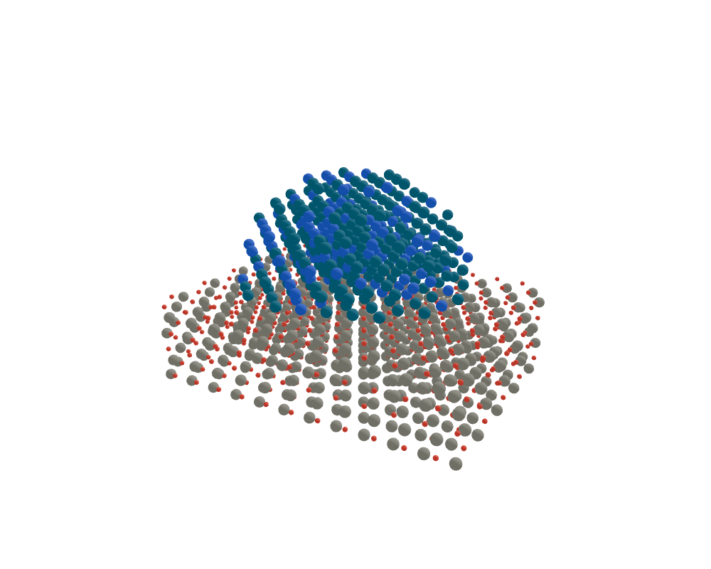
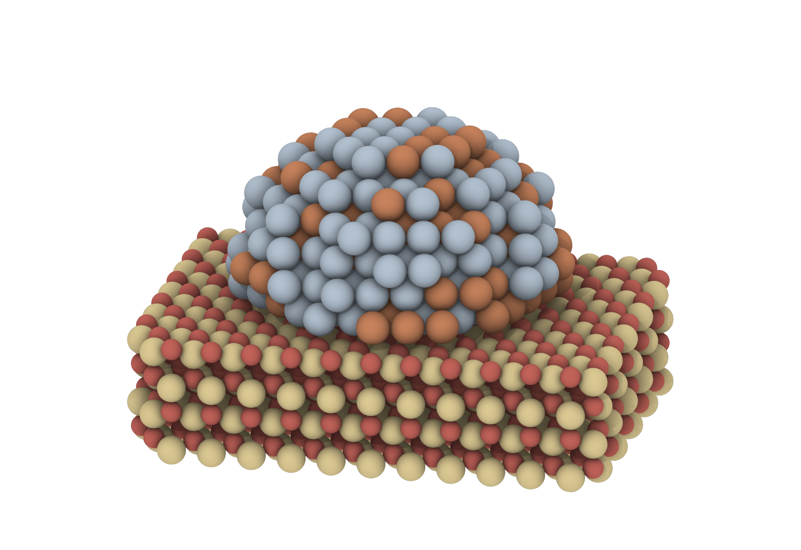
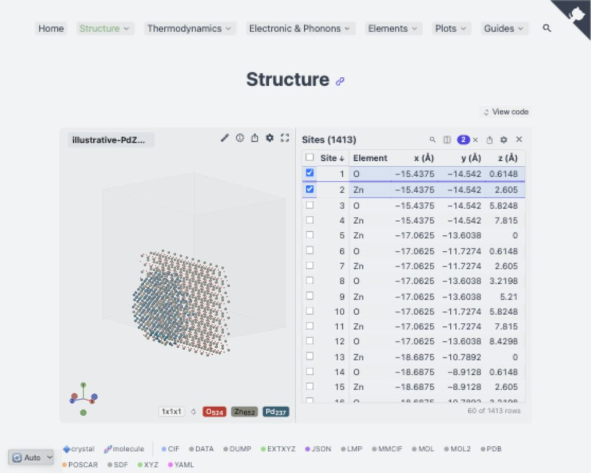
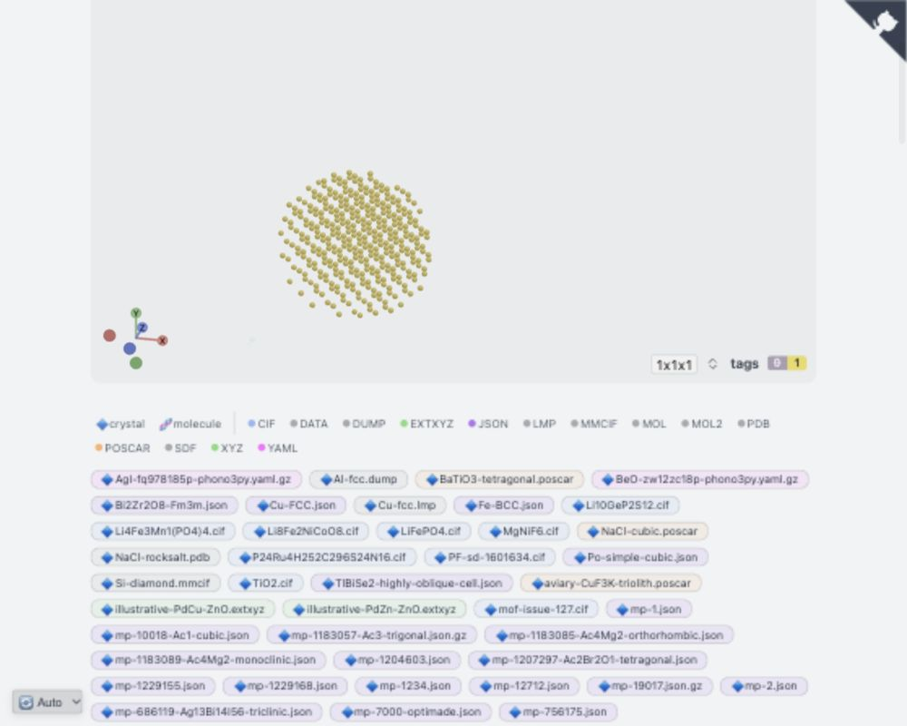

# Inspect the particle–support model with MatterViz

This example asks **which atoms belong to the particle or support, and whether the interface is hidden by the current projection**. It uses the original [PdZn/ZnO](../models/illustrative-PdZn-ZnO.extxyz) and [PdCu/ZnO](../models/illustrative-PdCu-ZnO.extxyz) files. Both are constructed, idealized, **unrelaxed illustrations**, not recovered paper coordinates or validated interfaces; see the [model assumptions](../README.md).

Each model has 1,413 sites: 1,048 support sites (`tags=0`) and 365 particle sites (`tags=1`). The 50 × 45 × 40 Å cell is retained, with **PBC false/false/false**. Negative x/y coordinates are intentional. Do not wrap them or strip the cell just to improve framing.

## Prepare and render

Use the [pinned MatterViz setup](../../../skills/ovito-structure/references/matterviz-setup.md). From the RSH root, with `MATTERVIZ_ROOT` set to that checkout:

```sh
export PLAYWRIGHT_BROWSERS_PATH="$MATTERVIZ_ROOT/.playwright-browsers"
node "$MATTERVIZ_ROOT/src/scripts/snapshot.mjs" \
  examples/supported-nanoparticles/models/illustrative-PdZn-ZnO.extxyz \
  examples/supported-nanoparticles/models/illustrative-PdCu-ZnO.extxyz \
  --out-dir work/matterviz-baseline \
  --props skills/ovito-structure/assets/matterviz-preview.json \
  --width 1000 --height 800 --dpi 72

node "$MATTERVIZ_ROOT/src/scripts/snapshot.mjs" \
  examples/supported-nanoparticles/models/illustrative-PdZn-ZnO.extxyz \
  examples/supported-nanoparticles/models/illustrative-PdCu-ZnO.extxyz \
  --out-dir work/matterviz-interface \
  --props examples/supported-nanoparticles/matterviz/inspection-view.json \
  --width 1000 --height 800 --dpi 72
```

Use new output directories when rerunning. The PNGs are 3D canvas snapshots: DOM legends, site tables and measurement labels are not included.

## Read the actual images

| Input | Default preview | Display-only adjustment | Existing OVITO render |
|---|---|---|---|
| PdZn/ZnO |  |  |  |
| PdCu/ZnO |  |  |  |

Open each image to inspect its original size. The default view lets the auxiliary cell dominate and projects the support nearly vertically, obscuring the interface. The adjusted view makes the supported-particle relationship easier to see. It hides only the **displayed** cell edges/surfaces and sets camera position, target, z-up, perspective, **45° field of view** and an atom-radius scale of 0.9. Coordinates, tags and cell/PBC remain intact.

These camera values are **specific to these two models**, not a general material preset. Hiding the box alone does not change the v0.9.0 auto-fit bounds. An initial manual-camera attempt inherited the default 10° field of view and severely cropped the model; specifying position without field of view was insufficient. Check the full image after each camera change.

The adjusted snapshot still has sparse-looking spheres, partial occlusion and less effective material/element differentiation than the existing OVITO renders. This example demonstrates inspection, **not publication-quality acceptance**. The renderer settings are not equivalent; the OVITO column is a qualitative reference, not a matched-camera benchmark or a new OVITO rerun.

## Inspect rather than merely export

In the local MatterViz `/structure` application, open the original ExtXYZ (for example by dragging it into the viewer). The recorded browser check loaded byte-identical copies from the local demo's `static/structures` directory; no format conversion was performed.

1. Check the element counts: PdZn has O 524 / Zn 652 / Pd 237; PdCu has O 524 / Zn 524 / Cu 128 / Pd 237. In **Show the site table**, inspect Element, x/y/z and `tags`, including the negative coordinates. Site 1 is O at approximately (-15.4375, -14.5420, 0.6148) Å; site 2 is Zn at (-15.4375, -14.5420, 2.6050) Å.
2. In **Structure controls**, set Bonds and Polyhedra to Never. Set cell Edge opacity and Surface opacity to 0 if the box obstructs inspection. This does not remove boundary metadata.
3. Select **Color by → Site Property → tags**. Rotate to a complementary view, then use **Hide 0** in the tags legend to inspect the particle without the support. Restore 0 to inspect their contact region. Property colors are group identity, not element identity; switch back to Element when identifying species.
4. Read a hovered site's element and xyz coordinates and cross-reference the source/table. Record a finding or an unresolved occlusion, rather than treating a successful export as inspection completion.

| Site table: source coordinates and tags | Hide support (`tags=0`) to inspect particle |
|---|---|
|  |  |

The screenshots show the PdZn model in the local v0.9.0 viewer. Table selection and measurement selection are distinct actions. The attempted two-point measurement did not yield a verified distance before the browser automation timed out; **distance measurement is not counted as passed**, and that timeout alone does not establish a MatterViz algorithm defect.

## Evidence and limits

Both files were parsed with MatterViz's own `parse_xyz` and compared site-by-site: elements/occupancy, coordinates, tags, cell and PBC matched; maximum Cartesian-coordinate difference was 0 Å. Both original files remained byte-identical after rendering and interaction. Rotation, site-table reading, hover coordinates, property coloring and group hiding were exercised in the PdZn browser view. Both models were rendered and visually reviewed.

This does not establish physical stability, realistic bonding or a valid interface mechanism. Mixed occupancy, periodic-image identity, editing/export round trips, multiple frames and VS Code integration were not tested here. OVITO remains the publication rendering path. Versions and normalized asset provenance are recorded in [verification.json](verification.json); installation failures and platform limits remain in [VERIFICATION.md](../../../VERIFICATION.md).
